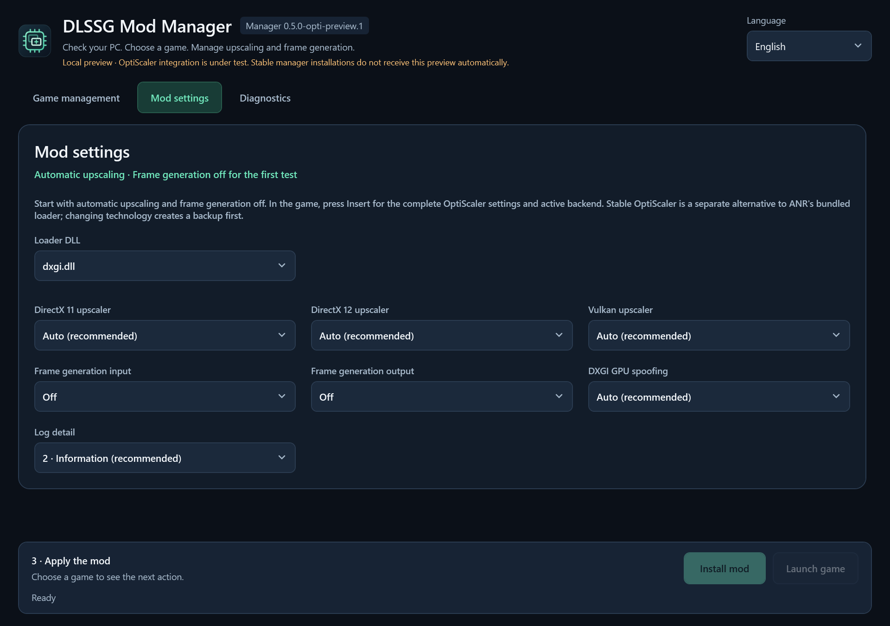

# DLSSG Mod Manager — دليل الاستخدام الكامل

**اللغة:** [English](../USER_GUIDE.md) · [Italiano](USER_GUIDE.it.md) · [简体中文](USER_GUIDE.zh-Hans.md) · [हिन्दी](USER_GUIDE.hi.md) · [Español](USER_GUIDE.es.md) · [Français](USER_GUIDE.fr.md) · **العربية** · [বাংলা](USER_GUIDE.bn.md) · [Português](USER_GUIDE.pt.md) · [Русский](USER_GUIDE.ru.md) · [اردو](USER_GUIDE.ur.md)

لـ **إصدار المدير 0.5.2** على **Windows 10/11 x64**. يمكنك اختيار لغة الواجهة من أعلى التطبيق. هذا مدير مستقل للمشروعات الأصلية، وليس تطبيقًا رسميًا من NVIDIA أو AMD أو Intel أو ANR أو OptiScaler.

**المحتويات:** [البداية السريعة](#start) · [السلامة](#safety) · [التنزيل](#install) · [اختيار التقنية](#choose-provider) · [الشاشة والأزرار](#screen) · [التثبيت الأول](#first-install) · [الفحوصات](#checks) · [إعدادات SM86](#sm86) · [إعدادات ANR](#anr) · [إعدادات OptiScaler](#optiscaler) · [إعدادات اللعبة](#in-game) · [التحقق](#verify) · [التحديثات](#updates) · [التعطيل والاستعادة](#backup) · [حل المشكلات](#troubleshooting) · [الملفات والمساعدة](#files) · [المصطلحات](#glossary) · [المصادر](#sources)

## 1. البداية السريعة: اختبارك الأول

داخل التطبيق افتح **دليل الاستخدام** واختر **بدء الجولة الإرشادية** لاتباع ثماني خطوات عملية. ابحث في المواضيع، أو استخدم **?** بجانب الإعداد، أو اضغط **F1** عندما يكون عنصر التحكم به محددًا بلوحة المفاتيح. يفتح **إظهار في المدير** عناصر التحكم المعنية ويبرزها دون تطبيق تغييرات.

1. أغلق اللعبة. اختر **لعبة فردية تعمل دون اتصال**.
2. افتح المدير وانتظر انتهاء فحص حزمة التقنية المحددة.
3. اختر التقنية ثم اللعبة من Steam، أو اختر مجلدها/ملف EXE الخاص بها. انتظر انتهاء التحليل.
4. اقرأ **2 · راجع النتيجة**. افتح **التشخيص** لرؤية القائمة الكاملة. عالج كل فحص **محظور**، واقرأ التحذيرات قبل المتابعة.
5. في **إعدادات التعديل**، اترك قيم الاختبار الأول: **SM86: ‏DLSS و2×**؛ **ANR: ‏Auto و2×**؛ **OptiScaler: رفع دقة تلقائي، ومدخل توليد الإطارات ومخرجه متوقفان**.
6. عد إلى **إدارة الألعاب**. اختر **تثبيت التعديل**، وراجع المجلد والإعدادات في نافذة التأكيد، ثم وافق وانتظر الاكتمال.
7. شغّل اللعبة واتبع [خطوات اللعبة الخاصة بالتقنية](#in-game). العب قليلًا وراقب الحركة وواجهة العرض واستجابة التحكم.
8. اقرأ السجل في **التشخيص**. مع OptiScaler، اضغط أيضًا **Insert** داخل اللعبة لمعرفة المخرج النشط. تحميل DLL وحده لا يثبت نجاح توليد الإطارات.

بعد نجاح الاختبار الأول، غيّر **إعدادًا واحدًا كل مرة**. أغلق اللعبة، وطبّق التغيير في المدير، ثم أعد تشغيل اللعبة قبل المقارنة.

## 2. اقرأ هذا قبل تعديل لعبة

**استخدم هذه التعديلات فقط في الألعاب الفردية دون اتصال. تعديل ملفات اللعبة قد يشغّل أنظمة مكافحة الغش أو يؤدي إلى الحظر.** لا يوفر المدير تجاوزًا لمكافحة الغش ولا حماية من الحظر. وضع عدم الاتصال لا يضمن غياب مكافحة الغش؛ واكتشافها يظل مانعًا للتثبيت.

يفحص المدير الملفات والمتطلبات. **«تم اكتشاف المتطلبات» لا يضمن توافق اللعبة أو استقرارها أو زيادة FPS.** احتفظ بنسخ عادية من ملفات الحفظ المهمة؛ نسخ المدير تخص تغييرات ملفات اللعبة التي يديرها، وليست نسخة من جميع ملفات الحفظ أو اللعبة كاملة.

لا تضف محمّلات فوق بعضها يدويًا، ولا تستبدل ملفات اللعبة بمكتبات DLL عشوائية، ولا تحذف ملفًا متعارضًا لمجرد إنجاح الفحص. افهم التعديل الموجود أولًا. تُنزَّل الملفات التنفيذية للمشروعات من مستودعاتها الأصلية كبيانات؛ ولا يشغّل المدير سكربتات تثبيتها.

## 3. تنزيل المدير وفتحه

استخدم [إصدارات المدير الرسمية](https://github.com/VenomDrake/DLSSG-Mod-Manager/releases/latest).

| التنزيل | ما تفعله |
|---|---|
| **ZIP محمول** | استخرج **ملف ZIP كاملًا** إلى مجلد قابل للكتابة، ثم افتح `DLSSGModManager.exe`. لا تشغّله من داخل ZIP. احتفظ بملفات التراخيص والتوثيق معه. |
| **مثبّت Windows ‏(.msi)** | أغلق المدير وشغّل MSI. يثبّت البرنامج لمستخدم Windows الحالي وينشئ اختصارات. |

تحتوي الحزم المنشورة على بيئة .NET الخاصة بالمدير. لا تحتاج إلى تثبيت Python أو CUDA Toolkit أو أداة استخراج منفصلة. قد تحتاج التقنية إلى تعريف رسومات أو Visual C++ أو مكونات Vulkan؛ وهذه فحوصات مستقلة.

المدير وMSI غير موقَّعين رقميًا. استخدم إصدارات المشروع التي تقصد تنزيلها فقط؛ ولا تعطّل حماية Windows بالكامل. يحتاج التشغيل الأول إلى الإنترنت لتنزيل حزمة التقنية. لاحقًا قد تستطيع استعمال حزمة مخزنة ومتحقق منها دون اتصال، لكن **وجود حزمة محلية لا يؤكد أنها أحدث إصدار**.

## 4. أي تقنية أختار؟

اختر من **رفع الدقة وتوليد الإطارات**. تسمّى التقنية أيضًا **مزوّدًا** في هذا الدليل.

| الاختيار | الغرض ومتطلبات الاختبار الأول |
|---|---|
| **DLSSG for SM86 · NVIDIA / XeSS** | المسار الذي راجعه المدير لبطاقات NVIDIA **RTX 20/30**، مع تعريف **R580 أو أحدث**، وإعداد جدولة GPU المسرّعة بالأجهزة (HAGS)، ومكتبة DLSS Frame Generation أصلية تدعمها اللعبة. تستخدم اللعبة DirectX 12. ابدأ بـ DLSS و2×. |
| **Apex Neural Rendering · تجريبي** | مزوّد FG بديل لعائلات **GTX 16 / RTX 20–50** و**Radeon RX 5000/6000/7000/9000** المعلنة ضمن دعم المدير. يحتاج إلى DLSS Frame Generation أصلي x64 في اللعبة عبر DX12/Vulkan، وVisual C++ x64 ومحمّل Vulkan. لا تدخل GTX 10/Pascal وIntel Arc ضمن دعم ANR في هذا المدير. ابدأ بـ Auto و2×. يظل ANR نفسه تجريبيًا. |
| **OptiScaler · رفع الدقة / توليد الإطارات** | يستبدل رافع الدقة الزمني DLSS/FSR/XeSS في لعبة متوافقة، ويمكنه إدارة مسارات FG المدعومة. **لا يلزم DLSS Frame Generation أصلي لرفع الدقة وحده**. تُعد NVIDIA وAMD وIntel مرشحة، لكن لكل مخرج قيوده الإضافية. ابدأ برفع الدقة Auto ومدخل/مخرج FG **متوقفين**. |

ليست HAGS وNVIDIA R580 **متطلبات عامة تنتقل تلقائيًا إلى ANR أو OptiScaler**. يظل **مخرج DLSS** الأصلي في OptiScaler بحاجة إلى NVIDIA RTX ومكتبة DLSS الخاصة باللعبة. لا يجعل OptiScaler كل محرك يعمل على كل GPU.

المسارات التي راجعها المدير 0.5.2 هي **SM86 0.4.1/0.4.2** و**ANR FG-V.B15/B17** و**OptiScaler 0.9.5**. قد تبقى حزمة أحدث من المشروع الأصلي محظورة إلى أن تُراجَع متطلباتها الجديدة.

يتذكر المدير المزوّد المحدد؛ لكنه **لا يختار الأفضل تلقائيًا لبطاقتك**. اختر التقنية المناسبة قبل تفسير فشل فحص GPU.

## 5. فهم الشاشة وجميع الأزرار الأساسية

يحتوي تبويب **دليل الاستخدام** على هذا الدليل الكامل دون اتصال، مع تنقّل بين المواضيع وبحث. تبقى الجولة الإرشادية بجانب المدير: ينتقل **رجوع** و**التالي** بين الخطوات الثماني، ويفتح **قراءة الشرح الكامل** الموضوع المرتبط، وينهي **إغلاق الجولة الإرشادية** الجولة. لا يجعل الانتقال إلى الخطوة التالية فحوص التوافق ناجحة؛ ما زال التثبيت يتطلب المراجعة والتأكيد المعتادين.

| المنطقة أو الأداة | وظيفتها |
|---|---|
| **إصدار المدير** | إصدار التطبيق، وهو منفصل عن إصدار حزمة التعديل المحددة. |
| **اللغة** | تغيّر لغة الواجهة. العربية والأردية تستخدمان اتجاه اليمين إلى اليسار. تبقى قيم الإعداد مثل `dxgi.dll` بكتابتها الأصلية. |
| **اختيار التقنية** | يختار SM86 أو ANR أو OptiScaler. تغييره يعيد فحص حزمة المزوّد ومتطلباته، ولا يعدّل اللعبة فورًا. |
| **إدارة الألعاب** | اختيار اللعبة ومراجعة النتيجة ثم تطبيق التعديل. |
| **إعدادات التعديل** | تعديل خيارات المزوّد المحدد. تغيير حقل وحده لا يكتب شيئًا في اللعبة. |
| **التشخيص** | كل الفحوصات وتفاصيل الحزمة/الكمبيوتر والسجلات وروابط التعريفات وتصدير التقرير والتعطيل والاستعادة. |
| **ألعاب Steam المثبتة / ↻** | يختار لعبة مكتشفة من Steam؛ ويحدّث ↻ المكتبات. وجود اللعبة في Steam لا يعني دعم التعديل لها. |
| **اختيار مجلد / اختيار ملف EXE** | اختيار يدوي للعبة، بما فيها الألعاب خارج Steam. اختر ملف الرسم الفعلي، لا المشغّل أو برنامج تقارير الأعطال أو المثبّت. |
| **حقل المسار / تحليل اللعبة** | يمكنك لصق مسار مجلد/EXE وتحليله. تغيير المسار يمحو النتيجة السابقة حتى لا تُستخدم بالخطأ. |
| **الملف التنفيذي للرسم** | يحسم الاختيار عند وجود مرشحين متعددين. في ألعاب Unreal كثيرة، استخدم `GameName\Binaries\Win64\...-Win64-Shipping.exe` بدل المشغّل الصغير في المجلد الرئيسي. |
| **عرض كل الفحوصات / تعديل إعدادات التعديل** | يفتح علامة التبويب المناسبة. |
| **تثبيت / تحديث / تطبيق الإعدادات / تبديل التقنية** | منطقة إجراء واحدة يتغير اسمها حسب الحالة. لا تطبّق التغييرات إلا بعد المتطلبات والتأكيد. |
| **تشغيل اللعبة** | يشغّل اللعبة المحددة عبر Steam عند مطابقتها، ولا يثبّت التعديل. |
| **إلغاء العملية** | يطلب توقفًا آمنًا. انتظر انتهاء الجزء الحرج من التطبيق أو التراجع. |

في **التشخيص**، يفحص **↻** الحزمة حزمة المشروع الأصلي، بينما يعيد **↻** الكمبيوتر قراءة العتاد. **فتح إعدادات الرسومات في Windows** يفتح الإعدادات ولا يفعّل HAGS نيابة عنك. تفتح أزرار التعريفات صفحات NVIDIA أو AMD أو Intel حسب المزوّد والبطاقات المكتشفة. يفتح **المشروع الأصلي** مستودع المزوّد.

الإشعار الصغير **التحديث وإعادة التشغيل** يخص **المدير نفسه**. زر **×** يخفي إشعار ذلك الإصدار في النافذة الحالية؛ ولا يزيل أي شيء.

## 6. التثبيت أو تغيير الإعدادات أو تبديل التقنية

1. انتظر تنزيل الحزمة والتحقق منها، واختر ملف EXE الصحيح للرسم.
2. راجع الملخص وكل الفحوصات. أغلق اللعبة وأي عملية متبقية تخصها.
3. اضبط قيم الاختبار الأول أو الخيارات المطلوبة. قد تتغير النتيجة إذا أضاف خيار متطلبًا جديدًا.
4. اضغط زر الإجراء السفلي. اقرأ التقنية ومجلد الرسم والإصدار والإعدادات في التأكيد.
5. وافق. يجهز المدير الملفات المتحقق منها، وينشئ نسخة احتياطية، ويعطّل المحمّلات القديمة، ويغيّر البيانات، ثم يفعّل المحمّل المختار أخيرًا. اتركه حتى ينتهي.
6. أعد تشغيل اللعبة. لا يمكن للعبة المفتوحة مسبقًا استخدام الإعدادات المكتوبة حديثًا بصورة موثوقة.

**«لديك أحدث إصدار بالفعل» تعني هوية الحزمة المثبتة.** لا تعني أن خيارًا عدّلته للتو قد طُبّق. أغلق اللعبة واستخدم **تطبيق الإعدادات** لحفظ التغييرات.

في تثبيت يديره المدير، يستخدم تبديل المزوّد نظام النسخ الاحتياطي والتاريخ نفسه. OptiScaler المستقل 0.9.5 ومحمّل OptiScaler المخصص ضمن ANR مختلفان؛ ولا يدمجهما المدير. قد يحتاج الانتقال من ANR Addon خارجي إلى استعادة التثبيت الخارجي أولًا. تُحمى التثبيتات اليدوية المجهولة بدل استبدالها بصمت.

## 7. قراءة الفحوصات دون تخمين

| الحالة | المعنى والتصرف |
|---|---|
| **ناجح** | نجح هذا الفحص تحديدًا. لا يثبت بقية المتطلبات أو أداء اللعبة. |
| **معلومات** | تفاصيل للسياق، مثل إعداد أو مكوّن اختياري. اقرأها عند الحاجة. |
| **تحذير / يحتاج إلى تحقق** | أمر يحتاج انتباهًا أو تأكيدًا داخل اللعبة. ليس مانعًا تلقائيًا، وليس وعدًا بأن المتابعة آمنة أو متوافقة. |
| **غير معروف** | تعذر على المدير إثبات معلومة. اقرأ التفاصيل بدل افتراض نجاحها. |
| **محظور** | لا يمكن متابعة التثبيت حتى تُحلّ المشكلة. |

تشمل الفحوصات المعتادة: Windows/x64، وGPU والتعريف، وHAGS حيث يلزم، ومكونات Visual C++/Vulkan، وهوية الحزمة وبنيتها المدعومة، واكتمال الفحص والصلاحيات، وملف EXE الصحيح، والمدخل/المكتبة الأصلية، ودلائل API الرسومات، ومكافحة الغش، والمحمّلات الموجودة أو المعدلة، واللعبة المفتوحة، والملفات المقروءة فقط، والمساحة الحرة. تحتاج النسخ الاحتياطية وتجهيز الملفات مساحة إضافية تتجاوز حجم التعديل النهائي.

**غير مدعوم** تعني اكتشاف عدم توافق تقني. **يحتاج إلى مراجعة** تعني أن الأدلة ناقصة أو EXE غير محدد أو أن المدخل قد يكون مدمجًا. **التثبيت محظور** قد يعني تعارضًا أو مشكلة في الحزمة، لا أن اللعبة غير مدعومة. فحص الملفات وحده لا يثبت غياب مكافحة الغش ولا يضمن تشغيل اللعبة.

## 8. SM86: شرح كل إعداد في المدير

**الاختبار الأول الموصى به:** DLSS، ‏2×، تحسين 1، إعداد مسبق A، تجاوز SR متوقف، سجل 2، تسجيل أزمنة الإطارات متوقف، و`version.dll`.

| الإعداد | شرح بسيط والاختيارات |
|---|---|
| **محرك التوليد** | يختار **NVIDIA DLSS-G** أو **Intel XeSS-FG** تنفيذ التوليد في التعديل. XeSS هنا تنفيذ تعديل SM86، وليس وعدًا بدعم بطاقات Intel عمومًا. ابدأ بـ DLSS. |
| **مضاعف الإطارات** | يعرض DLSS **2×–6×** وXeSS **2×–4×**. هذا طلب للمضاعف: 2× يعني إطارًا مولّدًا لكل إطار حقيقي، و3× يعني اثنين، وهكذا. قد تحد اللعبة القيمة، وقد يمنع الطلب غير المدعوم تشغيل FG. زيادة الإطارات لا تعني انخفاض التأخير بنفس النسبة ولا تضمن السلاسة. ابدأ بـ 2×. |
| **تحسين النوى** | **0:** النوى الأصلية للمقارنة. **1:** تسريعات تحافظ على الناتج الدقيق، وهو الموصى به. **2:** معالجة تقريبية أسرع. **3:** أقصى تقريب. قد تغيّر المستويات الأعلى النتيجة؛ قارن الحواف المتحركة والواجهة بدل اعتبار الرقم الأكبر أفضل دائمًا. يخص DLSS-G. |
| **إعداد DLSS-G المسبق** | **A:** الاختيار المعتاد للاختبار الأول. **B:** إعادة تركيب الواجهة إذا وفرت اللعبة صورًا مناسبة دون HUD وطبقة UI؛ لا ينشئ هذه الصور من العدم. **C:** توليد أخف قد يغيّر جودة الصورة، خاصة حول الواجهة وحواف الأجسام المحجوبة. يخص DLSS-G. |
| **تجاوز Super Resolution** | يحافظ **Off** على رفع الدقة الخاص باللعبة. يختار **M-INT8 / L-INT8** نوى M/L بنمط INT8 الخاصة بالمشروع، و**M-FP16 / L-FP16** المعالجة المقابلة بنمط FP16. الحرفان M/L اختيارا نموذج وليسا ترتيبًا عامًا للسرعة. قد ينخفض الأداء في Quality وBalanced وDLAA؛ اترك Off أولًا. |
| **التدفق البصري في XeSS** | تغيّر **Coarse وMiddle وFine** دقة معالجة التدفق. الدقة الأعلى قد تحتاج وقت GPU أكبر. يستخدم **CoarseAt4K** مستوى Coarse عندما يبلغ عدد بكسلات الخرج 3840×2160 على الأقل، وإلا Middle. ابدأ بـ Middle. يخص XeSS-FG. |
| **معالجة واجهة العرض في XeSS** | **Auto**، أو **اشتراط صورة دون HUD ‏(1)**، أو **عدم استخدام صورة دون HUD ‏(0)**. في SM86 **0.4.2 الذي تمت مراجعته، يتصرف Auto مثل 0**: يُجرى الاستيفاء للصورة كلها بما فيها الواجهة. يحتاج 1 إلى صورة مطابقة دون HUD توفرها اللعبة؛ وقد يفشل دونها. |
| **تفصيل السجل** | **0 متوقف**، **1 أخطاء**، **2 تشخيص (موصى به)**، **3 تتبّع تفصيلي**. التفاصيل تساعد في التشخيص لكنها تزيد حجم التسجيل. |
| **تسجيل أزمنة الإطارات** | يكتب بيانات توقيت إضافية للفحص. لا يضع حد FPS ولا يفعّل FG. اتركه متوقفًا أولًا. |
| **مكتبة DLL للتحميل** | `version.dll` (موصى بها)، و`winmm.dll` و`dbghelp.dll` و`dinput8.dll` و`dxgi.dll` و`d3d12.dll`. يحدد الاسم كيف تحمّل اللعبة التعديل. احتفظ بمحمّل نشط واحد؛ جرّب البدائل عبر المدير إذا لم يُحمّل التعديل، ولا تضف نسخًا يدويًا. |

لـ DLSS-G وXeSS-FG إعدادات مختلفة. ظهور خيار خاص بمحرك لا يجعله فعالًا عند اختيار المحرك الآخر.

**HAGS مع SM86:** افتح إعدادات رسومات Windows من التشخيص، وفعّل الجدولة المسرّعة بالأجهزة إذا أتاحتها Windows، ثم أعد تشغيل Windows. حالة الإعداد في السجل وحالة التفعيل الفعلي فحصان مختلفان؛ يوفر سجل اللعبة التأكيد الفعلي. لا يغيّر المدير التعريف أو HAGS تلقائيًا.

## 9. ANR: شرح كل إعداد في المدير

**الاختبار الأول الموصى به:** مسار حساب Auto، ‏2×، ‏80 شمعة/وحدة، ومعالجة قطع المشهد مفعّلة، و`dxgi.dll`. المحرك ANR؛ ولا تنطبق خيارات تحسين SM86 أو إعداده المسبق أو تجاوز SR.

| الإعداد أو الوضع | المعنى |
|---|---|
| **Full / Addon** | يختار المدير تلقائيًا. تتضمن **Full** إعداد المحمّل والمزوّد الذي تمت مراجعته. تضيف **Addon** مزوّد ANR إلى تثبيت OptiScaler خارجي متوافق وتحافظ على محمّله. الانتقال من OptiScaler مستقل يديره المدير إلى ANR يستخدم Full. لا تختر أو تنسخ addon عشوائيًا يدويًا. |
| **مضاعف الإطارات** | يطلب **2×–6×** بحسب تكامل اللعبة. ابدأ بـ 2×. يكتب المدير العدد المناسب من الإطارات الإضافية؛ اختيار 6× لا يعني ستة إطارات إضافية. |
| **مسار الحساب** | **auto وcoopmat وpacked وdp4a وportable وportable-linalg وportable-xmx** طرق بديلة لتنفيذ حسابات ANR، وليست مستويات جودة. يستخدم Auto منطق اختيار المزوّد؛ وتتطلب المسارات المحددة قدرات GPU مناسبة ولا يُضمن أن تعمل كلها أو تكون أسرع. اترك Auto إلا عند تشخيص مشكلة معينة. |
| **سطوع HDR** | المجال **40–1000** والافتراضي **80**، ويصف السطوع المرتبط بالقيمة الخطية 1.0 في معالجة HDR/PQ للمزوّد. ليس شريط سطوع الشاشة. اترك 80 ما لم يتطلب تشخيص HDR تغييره. |
| **معالجة قطع المشهد** | مفعّلة افتراضيًا؛ تمنع الاستيفاء عبر القطع المفاجئ للمشهد. اتركها مفعّلة للاختبار العادي. |
| **مكتبة DLL للتحميل** | `dxgi.dll` و`winmm.dll` و`version.dll`؛ ابدأ بـ `dxgi.dll`. في Addon يبقى المحمّل الخارجي ويُقفل الاختيار. |

تصف علامة **Beta** مزوّد ANR الأصلي، حتى عندما يكون المدير مستقرًا. يحتاج ANR إلى مكونات Visual C++ x64 التي تمت مراجعتها ومحمّل Vulkan حتى إن كانت اللعبة DX12. لا تُفرض عليه متطلبات HAGS الخاصة بـ SM86.

## 10. OptiScaler: شرح كل إعداد في المدير

**الاختبار الأول الموصى به:** كل خيارات رفع الدقة **Auto**، مدخل FG **متوقف**، ومخرجه **متوقف**، ومحاكاة GPU في DXGI على **Auto**، والسجل **2 · معلومات**، والمحمّل `dxgi.dll`.

### اختيارات رفع الدقة

**المدخل** هو التقنية المختارة في قائمة اللعبة. **المخرج** هو ما يشغّله OptiScaler فعليًا. مثلًا، قد توفر اللعبة مدخل DLSS بينما يخرج OptiScaler صورة XeSS. اختيار DLSS في قائمة اللعبة لا يثبت وحده أن DLSS هو المخرج الفعال.

| حقل المدير | القيم المتاحة |
|---|---|
| **رفع الدقة DirectX 11** | Auto؛ ‏FSR 2.2 ‏(`fsr22`)؛ ‏FSR 3.1 ‏(`fsr31`)؛ ‏XeSS أصلي ‏(`xess`)؛ ‏XeSS عبر D3D11on12 ‏(`xess_12`)؛ ‏FSR 2.1/2.2/3.1 عبر DX12 ‏(`fsr21_12` و`fsr22_12` و`fsr31_12`)؛ وDLSS. |
| **رفع الدقة DirectX 12** | Auto؛ ‏XeSS؛ ‏FSR 2.1؛ ‏FSR 2.2؛ ‏FSR 3.1/4؛ وDLSS. |
| **رفع الدقة Vulkan** | Auto؛ إصدارات FSR 2.1/2.2/3.1/4 الأصلية حسب دعم المحرك؛ ‏XeSS أصلي؛ ‏FSR 2.1 أو FSR 3.1/4 عبر DX12 ‏(`fsr21_12` و`fsr31_12`)؛ وDLSS. |

يستخدم API الفعال في اللعبة حقله المقابل فقط. يتبع **Auto** افتراضيات OptiScaler؛ وهو نقطة البداية الأكثر أمانًا وليس وعدًا بأسرع مخرج. تعني اللاحقة `_12` مسار تفاعل عبر DX12، وقد تكون له تكلفة إضافية.

يتطلب **XeSS الأصلي في DX11** بطاقة Intel Arc؛ أما `xess_12` فهو خيار تفاعل مختلف. يتطلب **مخرج DLSS** بطاقة NVIDIA RTX ومكتبة DLSS x64 الخاصة باللعبة. لا تعني **FSR 3.1/4** ضمان FSR 4 لكل GPU؛ فالمحرك والعتاد يحددان النموذج الفعال أو البديل. تحقق من المخرج الحقيقي في الواجهة داخل اللعبة؛ ولا يفرض المدير FSR 4 على عتاد غير مدعوم.

في DX11، المسار الأصلي `fsr31` هو FSR 3.1؛ أما FSR 4 فيستخدم التفاعل عبر DX12. عبارة «3.1 / 4» العامة لا تضمن FSR 4 أصليًا في DX11.

### مدخل توليد الإطارات ومخرجه

لأول اختبار لرفع الدقة وحده، اترك **الحقلين متوقفين**. لتفعيل FG لاحقًا، اختر مدخلًا **ومخرجًا** متوافقين؛ تشغيل أحدهما فقط يمنع المتابعة.

| مدخل FG | ما يجب أن توفره اللعبة |
|---|---|
| **متوقف** (`nofg`) | لا يُطلب توليد OptiScaler. أوقف المخرج أيضًا. |
| **DLSS Frame Generation** (`dlssg`) | ‏DLSS FG أصليًا مع تكامل Streamline 2 مناسب؛ يفحص المدير الأدلة المتاحة ويحذّر عند تعذر تأكيدها. |
| **DLSS-G · Nukem** (`nukems`) | مكتبة DLSS-G أصلية. اربطه بمخرج **Nukem · FSR 3**. |
| **FSR Frame Generation** (`fsrfg`) | مصدر FSR FG أصليًا متوافقًا داخل اللعبة. اسم DLL وحده لا يثبت التكامل. |
| **مدخل رفع الدقة / OptiFG** (`upscaler`) | مدخل رفع دقة زمنيًا يعمل، باستخدام مسار DX12 OptiFG الذي تمت مراجعته. قد يلزم تصحيح HUD في واجهة المشروع الأصلي. |
| **FSR 3.0 Frame Generation** (`fsrfg30`) | مصدر FSR 3.0 FG أصليًا متوافقًا. |

| مخرج FG | المعنى |
|---|---|
| **متوقف** | لا يوجد مخرج FG. أوقف المدخل أيضًا. |
| **AMD FSR Frame Generation** (`fsrfg`) | يستخدم محرك FidelityFX FG المتوافق. لا يضمن نفس إصدار FSR أو ميزاته على كل GPU. |
| **Intel XeSS Frame Generation** (`xefg`) | يحتاج إلى قدرات GPU التي يتطلبها المحرك، بما فيها دعم DP4a المناسب وشروط اللعبة/الشاشة. اكتشاف اسم Intel أو AMD أو NVIDIA وحده لا يكفي لتفعيله. للتوليد متعدد الإطارات قيود إضافية لدى المشروع الأصلي. |
| **Nukem · FSR 3** (`nukems`) | يستخدم مسار DLSSG-to-FSR3 المراجع والمرفق. وهو إلزامي عند اختيار مدخل Nukem. |

يمنع المدير 0.5.2 توليد الإطارات المحدد عندما يكتشف مسار **DX11**. وعند اكتشاف **Vulkan**، تكون المزاوجة المراجعة المسموحة هي **Nukem → Nukem**. تحتاج المسارات الأخرى المعروضة إلى DX12؛ وما زالت دلائل API المجهولة تحتاج إلى تأكيد داخل اللعبة. لا تجعل هذه الخيارات تكامل لعبة غير مدعوم متوافقًا.

### بقية الأدوات والإعدادات المتقدمة

| الإعداد | المعنى |
|---|---|
| **محاكاة GPU في DXGI: ‏Auto / تشغيل / إيقاف** | تغيّر هوية GPU المبلّغ عنها عبر DXGI للتوافق. لا تطوّر البطاقة الحقيقية ولا تضمن الأداء. ابدأ بـ Auto. ليست حماية من مكافحة الغش؛ استخدم التعديلات دون اتصال فقط. |
| **تفصيل السجل** | **0 تتبّع**، **1 تصحيح**، **2 معلومات (موصى به)**، **3 تحذير**، **4 خطأ**. بخلاف SM86، **لا تعني 0 إيقاف التسجيل**. يفعّل المدير التسجيل إلى ملف للتشخيص. |
| **مكتبة DLL للتحميل** | `dxgi.dll` و`winmm.dll` و`version.dll` و`d3d12.dll` و`dbghelp.dll` و`wininet.dll` و`winhttp.dll`. ابدأ بـ `dxgi.dll`، وغيّره من المدير عند الحاجة مع إغلاق اللعبة. |

اضغط **Insert** داخل اللعبة لفتح واجهة OptiScaler الكاملة وإعداداتها المتقدمة ومعلومات المحرك النشط. هذه الأدوات المتقدمة الكثيرة تابعة لـ OptiScaler؛ يعرض المدير الخيارات العامة المراجعة أعلاه. احتفظ بإعدادات أساسية تعمل، وغيّر شيئًا واحدًا كل مرة، واستخدم [الدليل الرسمي](https://github.com/optiscaler/OptiScaler/wiki) للأدوات غير الموجودة في المدير. تعليمات المستقر 0.9.5 وتعليمات v10 nightly غير قابلة للتبادل.

تطبيق الإعدادات من المدير يكتب قيمه المختارة مجددًا. إذا غيّرت الخيارات نفسها في واجهة اللعبة، اجعل اختيارات المدير متوافقة معها قبل التطبيق؛ وتُحفظ إعدادات INI غير المرتبطة حيثما كان ذلك مدعومًا.

## 11. ما الذي أختاره داخل اللعبة؟

**SM86 أو ANR:** فعّل خيار **NVIDIA DLSS Frame Generation** في اللعبة بعد التثبيت. ابدأ بـ 2× إن عرضته اللعبة. أعد تشغيل اللعبة إذا طلبت قائمتها ذلك. جودة رفع الدقة، مثل Quality أو Balanced، اختيار منفصل عن FG.

**أول اختبار لـ OptiScaler:** فعّل رافع دقة زمنيًا متوافقًا في اللعبة، واترك مدخل/مخرج FG متوقفين في المدير، وافحص المخرج الفعال عبر Insert. لا تحتاج إلى تشغيل DLSS FG لاختبار رفع الدقة فقط. عند اختيار مدخل FG أصلي لاحقًا، فعّل الميزة المقابلة داخل اللعبة. لمدخل Upscaler/OptiFG، استخدم مسار DX12 المراجع وإرشادات واجهة المشروع الأصلي.

قد يعني الخيار الرمادي **2×** ببساطة أن هذا المضاعف هو الوحيد المتاح. **لا يثبت ذلك أن FG يعمل.** لا يستطيع المدير فتح كل المضاعفات في قائمة كل لعبة. وقد تصف تسمية قائمة اللعبة المدخل بينما يستخدم OptiScaler مخرجًا آخر.

للمقارنة، استخدم المشهد والدقة والإعدادات نفسها. راقب النص المتحرك والأسوار وحواف الشخصيات وواجهة العرض، مع FPS واستجابة التحكم. الإطارات المولدة/المعروضة والإطارات الحقيقية التي رسمتها اللعبة قياسان مختلفان. لا يُفترض أن زيادة الإطارات المعروضة تضاعف الاستجابة.

## 12. التشخيص: كيف تعرف ما حدث؟

في **التشخيص**، اختر **قراءة سجل اللعبة** بعد اختبار قصير. يؤدي التشغيل عبر المدير وقراءة السجل إلى بدء القراءة الدورية ما دام المدير مفتوحًا. إن بقيت النتيجة قيد الانتظار، أغلق اللعبة واقرأ السجل المكتمل مجددًا.

| المزوّد | ما يستطيع المدير إثباته |
|---|---|
| **SM86** | يبحث في الجلسة المسجلة المطابقة عن إنشاء ميزة FG بنجاح وأول تنفيذ لها. مجرد تحميل التعديل أو وجود ميزة SR لا يكفي. اقرأ الأخطاء ومعلومات HAGS/GPU الفعلية. |
| **ANR** | يميّز التحميل والتهيئة عن عمليات توليد الإطارات الفعلية. يتطلب تأكيد FG جلسة كاملة مع عدد عمليات توليد موجب ودون أخطاء توليد. تساعد الأعداد والمضاعف المسجل في التشخيص. |
| **OptiScaler** | يعرض التحميل وأخطاء سجل الجلسة الحالية. تحميل DLL أو إنشاء swapchain **ليس دليلًا على نجاح SR أو FG أو زيادة الأداء**. افحص المحرك النشط وإحصاءات الإطارات والصورة في واجهة اللعبة. |

لا يثبت السجل الجزئي أو غير المكتمل أو الكبير جدًا نجاح الجلسة بالكامل. تعني **لا توجد أخطاء** أنه لم توجد أخطاء في الجزء الذي يفهمه القارئ، لا أن الأداء أو FG قد تأكدا. افحص وقت الجلسة المعروض حتى لا تخلط اختبارًا قديمًا بالحالي. ومع أكثر من GPU، تحقق من البطاقة التي تستخدمها اللعبة فعليًا.

## 13. ثلاثة أشياء مختلفة يمكن تحديثها

| التحديث | طريقة العمل |
|---|---|
| **تطبيق المدير** | يفحص إصدارات GitHub المستقرة عند التشغيل ودوريًا أثناء بقائه مفتوحًا، نحو كل ست ساعات. يظهر إشعار صغير فقط لإصدار مستقر أحدث. اختر **التحديث وإعادة التشغيل**؛ ينزّل حزمة ZIP/MSI المناسبة ويتحقق منها ثم يحدّث ويعيد التشغيل بموافقتك. أعد فتح المدير للفحص فورًا. يتجاهل الفحص المستقر العادي الإصدارات الأولية. |
| **حزمة المزوّد المنزّلة** | تُفحص للتقنية المحددة عند بدء التشغيل أو اختيارها؛ ويعيد ↻ الحزمة الفحص. يُحدَّث المخزون المحلي بتنزيل جديد متحقق منه، لكنه **لا يطبّق نفسه على ألعابك**. |
| **التعديل في لعبة واحدة** | اختر اللعبة وحلّلها ثم اضغط **تحديث التعديل** بعد الفحوصات والتأكيد. تبقى الألعاب الأخرى على تثبيتها الحالي حتى تحدّث كلًا منها على حدة. |

يقارن المدير معرّف الإصدار ومعرّف الملف وSHA-256؛ لذا يمكن اكتشاف استبدال ملف حتى مع بقاء رقم الإصدار الظاهر نفسه. **تم التنزيل** و**أحدث إصدار** و**مخزون دون اتصال** و**غير مدعوم بعد من هذا المدير** نتائج مختلفة. قد تنجح سلامة التنزيل مع بقاء طريقة التثبيت مجهولة. انتظر إصدار مدير يدعمها صراحة؛ ولا تفرضها بنسخ DLL يدويًا.

تستخدم الإصدارات **0.4.3 وما بعدها** المستودع المعاد تسميته. قد تحتاج الإصدارات **0.4.2 أو أقدم** إلى تحديث يدوي واحد باستخدام أحدث حزمة MSI/ZIP كاملة. كما تحتاج مشكلة نافذة التعليمات/الخطأ 1639 في محدّث MSI للإصدارين 0.2.0/0.2.1 إلى تثبيت يدوي لمرة واحدة لإصدار MSI أحدث ومصحح. حافظ على نوع التثبيت نفسه وأغلق المدير أولًا. اترك الألعاب ومجلدات النسخ الاحتياطية سليمة.

## 14. التعطيل وإعادة التفعيل والاستعادة وتبديل المزوّد

يوقف **تعطيل التعديل** تنشيط التعديل الذي يديره المدير مؤقتًا؛ وليس إزالة كاملة. يعطّل المدير المحمّل عادة ويُبقي المكتبات والبيانات والنسخ الاحتياطية. في ANR Addon خارجي، يستعيد اختيار OptiScaler الخارجي مع الإبقاء على محمّله.

لـ **إعادة التفعيل**، أبقِ اللعبة مغلقة واستخدم إجراء التثبيت/التحديث الرئيسي للمزوّد المحدد الذي يديره المدير.

تعيد **استعادة الحالة السابقة** النسخة المرتبطة بالتثبيت/التحديث/تبديل المزوّد الحالي الذي يديره المدير. ليست زرًا عامًا «للتراجع عن آخر زر»، وليست تراجعًا مخصصًا عن التعطيل. حسب التاريخ، قد تعيد إصدار تعديل أقدم أو مزوّدًا آخر أو تثبيتًا معطلًا أو الحالة الأصلية دون تعديل. قد تزيل استعادة نسخة ما قبل التثبيت الأول التعديل النشط. اقرأ التأكيد.

قد تشير سجلات التثبيت السابقة إلى نسخ أقدم؛ لذا قد تعود الاستعادات المتتالية إلى مراحل أسبق ما دام سجل إدارة موجودًا. لا توجد نافذة عامة لتصفح التاريخ وإعادة تنفيذ الإجراءات. تُحفظ النسخ؛ وقد تمنع الملفات المعدلة أو المجهولة الاستعادة بدل أن تُستبدل.

**لا تحذف يدويًا أبدًا** `.dlssg-manager.json` أو `.dlssg-manager.transaction.json` أو `.dlssg-manager-backups` لإزالة خطأ. إنها تحفظ ملكية الملفات ومعلومات التعافي. بعد عملية منقطعة، أغلق اللعبة واحتفظ بهذه الملفات وأعد فتح المدير. يستخدم التعافي سجل العملية أثناء التعامل مع الملفات. إذا ظل محظورًا، صدّر تقريرًا واطلب المساعدة بدل تفعيل المحمّلات أو حذفها يدويًا.

## 15. مشكلات شائعة والخطوة المناسبة

| ما تراه | ما تفعله |
|---|---|
| **زر التثبيت غير فعال** | انتظر العملية الحالية، واختر EXE الفعلي، وافحص العناصر المحظورة في التشخيص. نسخة القراءة فقط/معاينة الواجهة لا تثبّت. عالج السبب بدل نسخ الملفات يدويًا. |
| **GPU غير مدعوم** | افحص المزوّد المحدد أولًا. يتذكر المدير الاختيار أو يستخدم الافتراضي، ولا يختار أفضل تقنية لبطاقتك تلقائيًا. متطلبات ANR وOptiScaler تختلف عن SM86. |
| **اللعبة غير مدعومة / تحتاج مراجعة** | اقرأ السبب المحدد. غياب FG الأصلي مهم لـ SM86/ANR؛ وقد يحتاج OptiScaler إلى دليل مدخل SR زمني. قد يتعذر تحديد مدخل FSR المدمج. افحص API وEXE اللعبة. |
| **أحدث حزمة لكن التثبيت محظور** | سلامة الملف/أحدث إصدار منفصلان عن مراجعة طريقة التثبيت والعتاد وتوافق اللعبة. تتطلب الطريقة الجديدة المجهولة تحديث المدير ومراجعة. |
| **قائمة Steam فارغة أو اللعبة مفقودة** | حدّث مكتبات Steam، أو اختر المجلد أو ملف الرسم الفعلي يدويًا. |
| **عدة ملفات EXE** | اختر ملف الرسم الحقيقي. في Unreal، افحص `Binaries\Win64` ومرشح `Shipping.exe`. لا تختر مشغّلًا أو برنامج أعطال لتجاوز الغموض. |
| **اللعبة ما زالت تعمل** | أغلقها تمامًا وانتظر خروج العملية قبل التثبيت أو تغيير الإعدادات أو التبديل أو الاستعادة. |
| **HAGS مضبوط لكن التشغيل غير مؤكد** | لـ SM86، أعد تشغيل Windows بعد تمكين HAGS، واختبر اللعبة واقرأ أحدث سجل. قيمة السجل وحدها لا تثبت تشغيل HAGS في تلك الجلسة. |
| **Visual C++ / Vulkan مفقود** | استخدم مثبّتات Microsoft أو شركة GPU الرسمية، لا مواقع تنزيل DLL. يحتاج ANR إلى مكونات Visual C++ x64 المراجعة ومحمّل Vulkan. أعد فحص العتاد بعد ذلك. |
| **محمّل مجهول أو تعديل يدوي أو ملف متغير** | احتفظ به. حدّد التعديل الأصلي واستعده/أزله بالطريقة المدعومة لديه أو اطلب النصيحة مع التقرير. يحمي المدير الملفات الخارجية عمدًا، ولا يتبنّى OptiScaler اليدوي بصمت. |
| **سجل مفقود / تحميل فقط / 2× رمادي** | اتبع خطوات اللعبة المناسبة، واختبر قليلًا، ثم اقرأ السجل المكتمل. قد يلزم محمّل آخر إذا لم يُحمّل شيء. لا يثبت 2× الرمادي أو التحميل وحده عمل FG. |
| **ظلال متأخرة أو وميض أو تقطع أو FPS أسوأ** | عد إلى الأساس الموصى به. قارن تغييرًا واحدًا كل مرة، وقلل طلب FG عند الحاجة وافحص الأخطاء. جرّب التعطيل/الاستعادة عبر المدير. أكبر مضاعف أو أدق تدفق أو أعلى تقريب ليس الأفضل بالضرورة. |
| **الإعدادات لا تؤثر** | أغلق اللعبة وطبّق الإعدادات ثم أعد تشغيلها. افحص المحرك وAPI النشطين؛ فقد لا تكون إعدادات المحرك/API الآخر ذات صلة. |
| **عملية انقطعت أو استعادة محظورة** | أبقِ اللعبة مغلقة واحتفظ بالسجلات والنسخ. اقرأ الخطأ وصدّر تقريرًا واطلب المساعدة. لا تحذف سجل التعافي ولا تفرض ملفات مجهولة فوق النسخة الاحتياطية. |
| **لا يظهر تحديث المدير** | أعد فتح المدير وتحقق من الإنترنت والإصدار المثبت. تتجاهل الفحوصات العادية الإصدارات الأولية. قد تحتاج الإصدارات القديمة جدًا إلى التحديث اليدوي الواحد الموضح أعلاه. |

## 16. الملفات والخصوصية وطلب المساعدة

توجد تفضيلات التطبيق ومخزونه المحلي و`application.log` عادة في `%LOCALAPPDATA%\DLSSGModManager`. قد يستخدم مجلد بيانات مخصص أو تشغيل خاص لمعاينة الواجهة مكانًا آخر. تعيش سجلات ملكية ملفات اللعبة وسجل العملية والنسخ الاحتياطية بجوار **EXE الرسم**، وليس بالضرورة بجوار مشغّلها.

| المزوّد | مكان سجل اللعبة المعتاد نسبةً إلى مجلد الرسم |
|---|---|
| SM86 | `dlssg_sm86\logs\dlssg_sm86.log` |
| ANR | `OptiScaler\custom\Apex Neural Rendering FG\dlssg\nr_fg-*.log` |
| OptiScaler | `OptiScaler.log` |

اختر **تصدير تقرير التشخيص** في التشخيص وحدد مكان حفظ `DLSSG-diagnostic-report.json`. يتضمن إصدار المدير/المزوّد/الحزمة، وبصمة الحزمة وحالة تحديثها، وتفاصيل GPU/التعريف، والفحوصات وأدلة السجل المتاحة. يستبدل مسار جذر اللعبة المحددة وبادئة ملف المستخدم بعلامات مثل `<GAME>` و`<USER>`؛ راجع الملف قبل مشاركته لأن ذلك لا يضمن إزالة كل نص قد يكشف معلومات شخصية.

تُحفظ التقارير محليًا ولا تُرسل تلقائيًا. لا يوجد حساب أو قياس عن بُعد. عند طلب المساعدة، اذكر المزوّد واللعبة وإصدار المدير ورسالة المنع الدقيقة وما غيّرته. صورة النتيجة والتقرير أفضل من «لا يعمل». لا تشارك رموز وصول أو كلمات مرور أو ملفات شخصية غير مرتبطة.

## 17. قاموس صغير

| الكلمة | معناها ببساطة |
|---|---|
| **FPS الحقيقي/الأساسي** | الإطارات التي تحسبها اللعبة فعليًا. |
| **توليد الإطارات / FG** | إطارات إضافية تقديرية بين الإطارات الحقيقية. |
| **رفع الدقة / SR** | إعادة بناء صورة أعلى دقة من رسم أقل دقة. وهو منفصل عن FG. |
| **المدخل / المخرج** | ميزة اللعبة التي يعترضها OptiScaler / المحرك الذي يشغّله OptiScaler بدلًا منها. |
| **API: ‏DX11 وDX12 وVulkan** | واجهة الرسومات التي تستخدمها اللعبة؛ لكل API مسارات مدعومة مختلفة. |
| **HUD / دون HUD** | واجهة المعلومات على الشاشة / صورة اللعبة من دون هذه الواجهة. |
| **DLL / محمّل / proxy** | مكتبة برمجية والملف المسمى الذي تُحمّل اللعبة التعديل عبره. اسم الملف مهم. |
| **HAGS** | جدولة GPU المسرّعة بالأجهزة في Windows. |
| **Runtime** | مكوّن برمجي تحتاجه ميزة، مثل DLL DLSS للعبة أو Visual C++. |
| **Cache / SHA-256** | حزمة تنزيل محفوظة / بصمة لفحص سلامة الملف. تطابق البصمة لا يثبت التوافق في اللعبة ولا يجعل الطريقة المجهولة مدعومة. |
| **نسخة احتياطية / سجل العملية** | حالة الملفات السابقة / معلومات استعادة تغيير انقطع. |

## 18. المشروعات الأصلية وقراءة إضافية

- [تنزيلات المدير ومشروعه](https://github.com/VenomDrake/DLSSG-Mod-Manager).
- [DLSSG for SM86](https://github.com/sdli1995/dlssg_for_sm86)، من sdli1995 والمساهمين؛ و[تكييف SM75](https://github.com/Coldwood1026)، من Coldwood1026.
- [Apex Neural Rendering](https://github.com/apex-compute/ANR)، من Apex Compute والمساهمين.
- [OptiScaler](https://github.com/optiscaler/OptiScaler) و[الويكي الرسمية](https://github.com/optiscaler/OptiScaler/wiki)، من المساهمين في المشروع.
- [نظرة عامة على المدير](README.ar.md) و[إشعارات الأطراف الثالثة](../../THIRD_PARTY_NOTICES.md).

يصف هذا الدليل **الأدوات التي يعرضها المدير 0.5.2** وطرق تثبيت المزوّدين التي راجعها. ليس ضمانًا لتوافق كل لعبة، ولا اختبار أداء، ولا دليلًا كاملًا لكل خيار في واجهات المشروعات الأصلية. للميزات المتقدمة الموجودة فقط في المشروع الأصلي، استخدم توثيق نسخته المناسبة.
