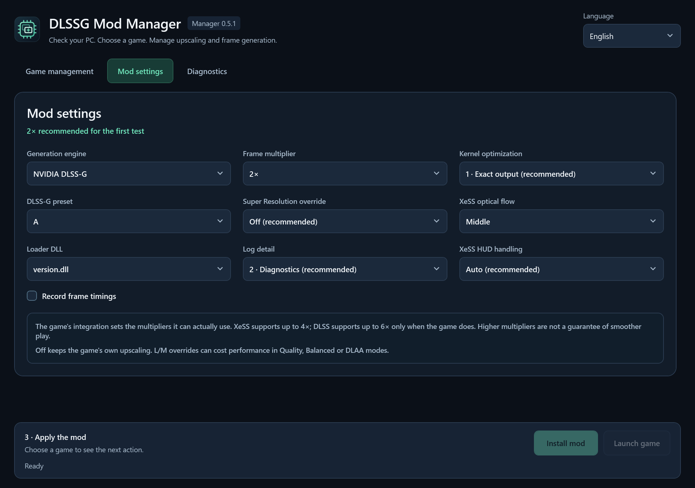

# DLSSG Mod Manager — tutoriel d’utilisation complet

**Langue :** [English](../USER_GUIDE.md) · [Italiano](USER_GUIDE.it.md) · [简体中文](USER_GUIDE.zh-Hans.md) · [हिन्दी](USER_GUIDE.hi.md) · [Español](USER_GUIDE.es.md) · **Français** · [العربية](USER_GUIDE.ar.md) · [বাংলা](USER_GUIDE.bn.md) · [Português](USER_GUIDE.pt.md) · [Русский](USER_GUIDE.ru.md) · [اردو](USER_GUIDE.ur.md)

Pour le **gestionnaire 0.5.1** sous **Windows 10/11 x64**. Les noms ci-dessous se basent sur l’interface anglaise et sont présentés ici en traduction ; choisissez votre langue en haut à droite de l’application. Il s’agit d’un gestionnaire indépendant pour les projets d’origine, et non d’une application officielle NVIDIA, AMD, Intel, ANR ou OptiScaler.

**Sommaire :** [Démarrage rapide](#start) · [Sécurité](#safety) · [Téléchargement](#install) · [Choisir une technologie](#choose-provider) · [Écran et boutons](#screen) · [Première installation](#first-install) · [Vérifications](#checks) · [Réglages SM86](#sm86) · [Réglages ANR](#anr) · [Réglages OptiScaler](#optiscaler) · [Réglages dans le jeu](#in-game) · [Vérification du résultat](#verify) · [Mises à jour](#updates) · [Désactiver et rétablir](#backup) · [Dépannage](#troubleshooting) · [Fichiers et aide](#files) · [Glossaire](#glossary) · [Sources](#sources)

## 1. Démarrage rapide : votre premier essai

1. Fermez le jeu. Choisissez un **jeu solo hors ligne**.
2. Ouvrez le gestionnaire et laissez la vérification du paquet de la technologie sélectionnée se terminer.
3. Choisissez la technologie, puis sélectionnez le jeu dans Steam ou choisissez son dossier/EXE. Laissez le gestionnaire l’analyser.
4. Lisez **2 · Examiner le résultat**. Ouvrez **Diagnostic** pour voir la liste complète. Résolvez toutes les vérifications **Bloquées** ; lisez les avertissements avant de continuer.
5. Dans **Réglages du mod**, conservez les valeurs du premier essai : **SM86 : DLSS, 2×** ; **ANR : Auto, 2×** ; **OptiScaler : mise à l’échelle automatique, entrée FG désactivée et sortie FG désactivée**.
6. Revenez à **Gestion des jeux**. Choisissez **Installer le mod**, vérifiez la cible et les réglages dans la confirmation, puis confirmez. Attendez la fin.
7. Lancez le jeu et suivez les [étapes dans le jeu propres à chaque fournisseur](#in-game). Jouez brièvement en observant les mouvements, le HUD et la réactivité.
8. Lisez le journal dans **Diagnostic**. Pour OptiScaler, appuyez aussi sur **Insert** dans le jeu pour examiner la sortie active. Le simple chargement d’une DLL ne prouve pas que la génération d’images fonctionne.

Changez **un seul réglage à la fois** après un premier essai concluant. Fermez le jeu, appliquez le changement dans le gestionnaire et redémarrez le jeu avant de comparer.

## 2. À lire avant de modifier un jeu

**Utilisez ces mods uniquement dans des jeux solo hors ligne. Les fichiers de jeu modifiés peuvent déclencher l’anti-triche ou entraîner des bannissements.** Le gestionnaire ne fournit aucun contournement de l’anti-triche ni protection contre les bannissements. Un mode hors ligne ne garantit pas l’absence d’anti-triche ; un anti-triche détecté bloque toujours l’installation.

Le gestionnaire vérifie les fichiers et les prérequis. **« Prérequis détectés » ne certifie ni la compatibilité en jeu, ni la stabilité, ni un gain de FPS.** Conservez vos sauvegardes habituelles des parties importantes ; les copies du gestionnaire couvrent ses modifications des fichiers du jeu, pas toutes les parties sauvegardées ni le jeu entier.

N’empilez pas manuellement des chargeurs, ne copiez pas des DLL d’origine inconnue sur les fichiers du jeu et ne supprimez pas un conflit uniquement pour faire réussir une vérification. Examinez d’abord le mod existant. Les binaires des projets d’origine sont téléchargés depuis leurs dépôts comme données ; le gestionnaire n’exécute pas leurs scripts d’installation.

## 3. Télécharger et ouvrir le gestionnaire

Utilisez les [versions officielles du gestionnaire](https://github.com/VenomDrake/DLSSG-Mod-Manager/releases/latest).

| Téléchargement | Marche à suivre |
|---|---|
| **ZIP portable** | Extrayez le **ZIP entier** dans un dossier accessible en écriture, puis ouvrez `DLSSGModManager.exe`. Ne l’exécutez pas depuis l’intérieur du ZIP. Conservez ensemble ses fichiers de licence et de documentation. |
| **Programme d’installation Windows (.msi)** | Fermez le gestionnaire et lancez le MSI. Il s’installe pour votre utilisateur Windows et crée des raccourcis. |

Les paquets publiés incluent l’environnement d’exécution .NET du gestionnaire. Vous n’avez pas besoin d’installer Python, CUDA Toolkit ou un outil d’extraction d’archives séparé. Un fournisseur peut toujours nécessiter des pilotes graphiques, Visual C++ ou des composants Vulkan ; ces éléments font l’objet de vérifications distinctes.

Le gestionnaire et le MSI ne sont pas signés. Utilisez uniquement les versions du projet que vous aviez l’intention de télécharger ; ne désactivez pas globalement la sécurité de Windows. Le premier lancement nécessite internet pour obtenir le paquet d’un fournisseur. Par la suite, un paquet vérifié en cache peut être utilisable hors ligne, mais **un cache hors ligne ne confirme pas qu’il s’agit de la dernière version**.

## 4. Quelle technologie choisir ?

Choisissez dans **Mise à l’échelle et génération d’images**. Dans ce guide, une technologie est aussi appelée un **fournisseur**.

| Choix | Objectif et prérequis du premier essai |
|---|---|
| **DLSSG for SM86 · NVIDIA / XeSS** | La procédure examinée par le gestionnaire pour les **NVIDIA RTX 20/30**, le pilote **R580 ou plus récent**, la planification GPU à accélération matérielle (HAGS) configurée et un environnement d’exécution DLSS Frame Generation natif compatible dans le jeu. Le jeu utilise DirectX 12. Commencez avec DLSS et 2×. |
| **Apex Neural Rendering · Beta** | Un autre fournisseur FG pour les familles déclarées compatibles par le gestionnaire : **GTX 16 / RTX 20–50** et **Radeon RX 5000/6000/7000/9000**. Il nécessite DLSS Frame Generation natif x64 dans le jeu via DX12/Vulkan, Visual C++ x64 et un chargeur Vulkan. GTX 10/Pascal et Intel Arc ne font pas partie du périmètre ANR pris en charge par ce gestionnaire. Commencez avec Auto et 2×. ANR reste en bêta. |
| **OptiScaler · Mise à l’échelle / FG** | Remplace la mise à l’échelle temporelle DLSS/FSR/XeSS d’un jeu compatible et peut gérer les voies FG prises en charge. DLSS Frame Generation natif **n’est pas requis pour la seule mise à l’échelle**. NVIDIA, AMD et Intel sont des candidats possibles, mais chaque sortie a des limites supplémentaires. Commencez avec la mise à l’échelle Auto et la FG **désactivée/désactivée (Off/Off)**. |

HAGS et NVIDIA R580 **ne sont pas des prérequis universels** transmis à ANR ou OptiScaler. La **sortie** DLSS native dans OptiScaler nécessite toujours une NVIDIA RTX et l’environnement d’exécution DLSS du jeu. OptiScaler ne fait pas fonctionner tous les moteurs sur tous les GPU.

Les procédures examinées par le gestionnaire 0.5.1 sont **SM86 0.4.1/0.4.2**, **ANR FG-V.B15/B17** et **OptiScaler 0.9.5**. Un téléchargement plus récent du projet d’origine peut rester bloqué jusqu’à l’examen de ses prérequis modifiés.

Le gestionnaire mémorise le fournisseur sélectionné ; il **ne choisit pas automatiquement** le meilleur fournisseur pour votre GPU. Sélectionnez une technologie adaptée avant d’interpréter un échec de vérification GPU.

## 5. Comprendre l’écran et chaque bouton principal

| Zone ou commande | Fonction |
|---|---|
| **Version du gestionnaire** | La version de l’application. Elle est distincte de la version du paquet du mod sélectionné. |
| **Langue** | Change la langue de l’interface. L’arabe et l’ourdou utilisent une disposition de droite à gauche. Les valeurs de configuration comme `dxgi.dll` gardent leur orthographe d’origine. |
| **Sélecteur de technologie** | Choisit SM86, ANR ou OptiScaler. Le changer revérifie le paquet et les prérequis du fournisseur ; cela ne modifie pas immédiatement le jeu. |
| **Gestion des jeux** | Choisir le jeu, examiner le résultat, puis appliquer le mod. |
| **Réglages du mod** | Modifier les réglages du fournisseur sélectionné. Modifier un champ seul n’écrit rien dans le jeu. |
| **Diagnostic** | Vérifications complètes, détails du paquet/PC, journaux, liens vers les pilotes, export de rapports, désactivation et rétablissement. |
| **Jeux Steam installés / ↻** | Sélectionne un jeu Steam détecté ; ↻ actualise les bibliothèques. La présence d’un jeu dans Steam n’implique pas qu’il soit compatible avec le mod. |
| **Choisir un dossier / Choisir un EXE** | Sélectionne manuellement un jeu, y compris hors Steam. Choisissez le véritable EXE de rendu, pas un lanceur, un outil de rapport de plantage ou un programme d’installation. |
| **Champ du chemin / Analyser le jeu** | Vous pouvez coller un chemin de dossier/EXE, puis l’analyser. Changer le chemin efface le résultat précédent pour éviter de le réutiliser par erreur. |
| **Exécutable de rendu** | Permet de départager plusieurs candidats. Pour beaucoup de jeux Unreal, utilisez `GameName\Binaries\Win64\...-Win64-Shipping.exe`, pas le petit lanceur du dossier principal. |
| **Voir toutes les vérifications / Ajuster les réglages du mod** | Ouvre l’onglet correspondant. |
| **Installer / Mettre à jour / Appliquer les réglages / Changer de technologie** | Une même zone d’action dont le libellé correspond à la situation. Elle applique les changements seulement après confirmation et satisfaction des prérequis. |
| **Lancer le jeu** | Lance le jeu sélectionné en utilisant Steam lorsqu’une correspondance existe. N’installe pas le mod. |
| **Annuler l’opération** | Demande un arrêt sûr. Attendez que le gestionnaire termine une phase critique d’application des changements ou de retour en arrière. |

Dans **Diagnostic**, le **↻** du paquet vérifie le paquet du projet d’origine, tandis que le **↻** du PC relit le matériel. **Ouvrir les paramètres graphiques Windows** ouvre les paramètres Windows ; cela n’active pas HAGS pour vous. Les boutons de pilotes ouvrent les pages NVIDIA, AMD ou Intel selon le fournisseur/les adaptateurs sélectionnés. **Projet d’origine** ouvre le dépôt du fournisseur.

Le petit avis **Mettre à jour et redémarrer** concerne **le gestionnaire lui-même**. Son **×** masque l’avis de cette version pour la fenêtre actuelle ; il ne désinstalle rien.

## 6. Installer, modifier les réglages ou changer de technologie

1. Terminez le téléchargement/la vérification du paquet et sélectionnez le bon EXE de rendu.
2. Examinez le résumé et les vérifications complètes. Fermez le jeu et tout processus du jeu encore actif.
3. Choisissez les valeurs du premier essai ou les options souhaitées. Le résultat peut changer lorsqu’une option ajoute un prérequis.
4. Appuyez sur le bouton d’action en bas. Lisez la technologie, le dossier de rendu, la version et les réglages dans la confirmation.
5. Confirmez. Le gestionnaire prépare les fichiers vérifiés, crée une copie de sécurité, désactive les anciens chargeurs, modifie les données et active le chargeur sélectionné en dernier. Laissez-le terminer.
6. Redémarrez le jeu. Un jeu déjà ouvert ne peut pas utiliser de manière fiable les réglages nouvellement écrits.

**« Vous avez déjà la dernière version » concerne l’identité du paquet installé.** Cela ne signifie pas qu’un réglage que vous venez de changer a déjà été appliqué. Utilisez **Appliquer les réglages**, jeu fermé, pour enregistrer ces changements.

Pour une installation gérée, le changement de fournisseur utilise le même système de copies de sécurité et d’historique. OptiScaler autonome 0.9.5 et le chargeur OptiScaler personnalisé d’ANR sont différents ; le gestionnaire ne les fusionne pas. Un Addon ANR externe peut nécessiter le rétablissement de l’installation externe avant de changer. Les installations manuelles inconnues sont protégées plutôt qu’écrasées sans avertissement.

## 7. Lire les vérifications sans deviner

| État | Signification et action |
|---|---|
| **Réussi** | Cette vérification précise a réussi. Cela ne prouve ni tous les autres prérequis ni le fonctionnement en jeu. |
| **Information** | Un contexte, par exemple un réglage ou un composant facultatif. Lisez-le s’il vous concerne. |
| **Avertissement / À vérifier** | Un point demande votre attention ou une confirmation dans le jeu. Il n’est pas automatiquement bloquant ; il ne promet pas non plus qu’il est sûr ou compatible de continuer. |
| **Non confirmé** | Le gestionnaire n’a pas pu établir un fait. Lisez le détail plutôt que de considérer la vérification comme réussie. |
| **Bloqué** | L’installation ne peut pas continuer tant que la cause n’est pas résolue. |

Les vérifications habituelles portent sur Windows/x64, le GPU et le pilote, HAGS si nécessaire, les composants Visual C++/Vulkan, l’identité et la structure prise en charge du paquet, le caractère complet de l’analyse/les permissions, le bon EXE, l’entrée/l’environnement d’exécution natif, les indices d’API graphique, les indicateurs d’anti-triche, les chargeurs existants ou modifiés, le jeu en cours d’exécution, les cibles en lecture seule et l’espace disque libre. Les copies de sécurité et la préparation demandent de l’espace au-delà de la taille finale du mod.

**Non pris en charge** indique une incompatibilité technique détectée. **À examiner** signifie que les indices sont incomplets, qu’un EXE est ambigu ou qu’une entrée peut être intégrée au jeu. **Installation bloquée** peut indiquer un conflit ou un problème de paquet plutôt qu’un jeu incompatible. Une analyse statique des fichiers ne peut pas prouver l’absence d’anti-triche ni garantir le fonctionnement du jeu.

## 8. SM86 : chaque réglage du gestionnaire

**Premier essai recommandé :** DLSS, 2×, optimisation 1, préréglage A, remplacement SR désactivé, journal 2, enregistrement des temps désactivé, `version.dll`.

| Réglage | Explication simple et choix |
|---|---|
| **Moteur de génération** | **NVIDIA DLSS-G** ou **Intel XeSS-FG** sélectionne l’implémentation FG du mod. Ici, XeSS désigne l’implémentation du mod SM86, pas une promesse de prise en charge générale des GPU Intel. Commencez avec DLSS. |
| **Multiplicateur d’images** | DLSS propose **2×–6×** ; XeSS **2×–4×**. Ces valeurs demandent un multiplicateur : 2× signifie une image générée par image réelle ; 3× en signifie deux, et ainsi de suite. Le jeu peut imposer une limite inférieure, et une demande non prise en charge peut empêcher la FG. Commencez à 2×. Plus d’images générées ne signifient pas une latence proportionnellement plus faible ni une fluidité garantie. |
| **Optimisation des noyaux** | **0 :** noyaux d’origine, utiles pour comparer. **1 :** accélérations à sortie exacte, recommandé. **2 :** traitement approximatif plus rapide. **3 :** approximation maximale. Les niveaux supérieurs peuvent changer le résultat ; comparez les contours en mouvement et l’interface au lieu de supposer que le plus grand nombre est le meilleur. S’applique à DLSS-G. |
| **Préréglage DLSS-G** | **A :** choix normal du premier essai. **B :** recomposition de l’interface lorsque le jeu fournit des tampons adaptés sans HUD/d’interface ; il ne peut pas créer ces tampons. **C :** FG plus légère avec un compromis possible sur la qualité d’image, notamment autour des contours du HUD/d’occlusion. S’applique à DLSS-G. |
| **Remplacement de Super Resolution** | **Désactivé (Off)** conserve la mise à l’échelle du jeu. **M-INT8 / L-INT8** sélectionne les noyaux M/L INT8 du projet. **M-FP16 / L-FP16** sélectionne le traitement FP16 correspondant. M/L sont des choix de modèle, pas un classement universel des performances. Les remplacements peuvent réduire les performances dans les modes Qualité, Équilibré ou DLAA ; laissez-les désactivés pour le premier essai. |
| **Flux optique XeSS** | **Coarse**, **Middle**, **Fine** changent la résolution du traitement du flux. Un traitement plus fin peut demander davantage de temps GPU. **CoarseAt4K** utilise Coarse pour une sortie d’au moins 3840×2160 pixels, sinon Middle. Commencez avec Middle. S’applique à XeSS-FG. |
| **Gestion du HUD XeSS** | **Auto**, **Exiger une image sans HUD (1)** ou **Ne pas utiliser d’image sans HUD (0)**. Dans la version examinée de SM86 **0.4.2, Auto se comporte comme 0** : toute l’image, interface comprise, est interpolée. Le mode 1 nécessite que le jeu fournisse une image correspondante sans HUD et peut échouer si elle n’existe pas. |
| **Détail du journal** | **0 Désactivé**, **1 Erreurs**, **2 Diagnostic (recommandé)**, **3 Traces détaillées**. Davantage de détails aide au diagnostic, mais augmente le volume du journal. |
| **Enregistrer les temps d’images** | Écrit des données temporelles supplémentaires pour l’analyse. Ne définit pas de limite de FPS et n’active pas la FG. Laissez désactivé pour le premier essai. |
| **DLL de chargement** | `version.dll` (recommandée), `winmm.dll`, `dbghelp.dll`, `dinput8.dll`, `dxgi.dll`, `d3d12.dll`. Le nom du fichier détermine comment le jeu charge le mod. Gardez un seul chargeur actif ; essayez les alternatives via le gestionnaire si le mod ne se charge pas. N’empilez pas de copies manuellement. |

DLSS-G et XeSS-FG ont des réglages différents. Une option propre à un moteur peut être visible sans être active lorsque l’autre moteur est sélectionné.

**HAGS pour SM86 :** ouvrez les paramètres graphiques Windows depuis Diagnostic, activez la planification GPU à accélération matérielle si Windows la propose, puis redémarrez Windows. L’état du registre/de la configuration et l’état réellement actif à l’exécution sont des vérifications distinctes. Le journal du jeu fournit la confirmation à l’exécution. Le gestionnaire ne change pas automatiquement le pilote ou HAGS.

## 9. ANR : chaque réglage du gestionnaire

**Premier essai recommandé :** voie de calcul Auto, 2×, 80 nits par unité, gestion des changements de scène activée, `dxgi.dll`. Le moteur est ANR ; les commandes d’optimisation/préréglage/remplacement SR de SM86 ne s’appliquent pas.

| Réglage ou mode | Signification |
|---|---|
| **Full / Addon** | Sélectionné automatiquement. **Full** inclut la configuration chargeur/fournisseur examinée. **Addon** ajoute ANR à une installation OptiScaler externe compatible et conserve ce chargeur. Un changement géré OptiScaler autonome → ANR utilise Full. Ne choisissez ni ne copiez manuellement un addon quelconque. |
| **Multiplicateur d’images** | Demande **2×–6×**, selon l’intégration du jeu. Commencez à 2×. Le gestionnaire écrit le nombre correspondant d’images supplémentaires, pas six images supplémentaires pour le choix 6×. |
| **Voie de calcul** | **auto**, **coopmat**, **packed**, **dp4a**, **portable**, **portable-linalg**, **portable-xmx** sont différentes manières d’effectuer les calculs ANR. Ce ne sont pas des niveaux de qualité d’image. Auto utilise la logique de sélection du fournisseur ; les voies explicites nécessitent des capacités GPU adaptées et ne sont pas toutes garanties de fonctionner ou d’être plus rapides. Conservez Auto, sauf pour diagnostiquer un problème précis. |
| **Luminance HDR** | **40–1000**, valeur par défaut **80**, décrit la luminance associée à une valeur linéaire de 1.0 dans le traitement HDR/PQ du fournisseur. Ce n’est pas le curseur de luminosité du moniteur. Conservez 80 sauf si une analyse spécifique au HDR nécessite un changement. |
| **Gestion des changements de scène** | Activée par défaut ; évite d’interpoler entre des coupes brusques. Gardez-la activée pour les essais habituels. |
| **DLL de chargement** | `dxgi.dll`, `winmm.dll`, `version.dll` ; commencez avec `dxgi.dll`. En mode Addon, le chargeur externe est conservé et le sélecteur est verrouillé. |

La mention **Beta** d’ANR décrit le fournisseur d’origine, même lorsque le gestionnaire est une version stable. ANR nécessite les composants Visual C++ x64 examinés et le chargeur Vulkan même si l’API graphique du jeu est DX12. Le prérequis HAGS de SM86 n’est pas imposé.

## 10. OptiScaler : chaque réglage du gestionnaire

**Premier essai recommandé :** toutes les mises à l’échelle sur **Auto**, entrée FG **désactivée (Off)**, sortie FG **désactivée (Off)**, identité GPU simulée dans DXGI **Auto**, journal **2 · Informations**, chargeur `dxgi.dll`.

### Choix de mise à l’échelle

Une **entrée** est la technologie sélectionnée dans le menu du jeu. Une **sortie** est ce qu’OptiScaler exécute réellement. Par exemple, un jeu peut fournir une entrée DLSS alors qu’OptiScaler produit une sortie XeSS. Sélectionner DLSS comme entrée du jeu ne prouve pas en soi que DLSS est la sortie active.

| Champ du gestionnaire | Valeurs disponibles |
|---|---|
| **Mise à l’échelle DirectX 11** | Auto ; FSR 2.2 (`fsr22`) ; FSR 3.1 (`fsr31`) ; XeSS natif (`xess`) ; XeSS via D3D11on12 (`xess_12`) ; FSR 2.1/2.2/3.1 via l’interopérabilité DX12 (`fsr21_12`, `fsr22_12`, `fsr31_12`) ; DLSS. |
| **Mise à l’échelle DirectX 12** | Auto ; XeSS ; FSR 2.1 ; FSR 2.2 ; FSR 3.1/4 ; DLSS. |
| **Mise à l’échelle Vulkan** | Auto ; FSR 2.1/2.2/3.1/4 natif selon la prise en charge du moteur ; XeSS natif ; FSR 2.1 ou FSR 3.1/4 via l’interopérabilité DX12 (`fsr21_12`, `fsr31_12`) ; DLSS. |

Seule l’API active du jeu utilise son réglage correspondant. **Auto** suit les valeurs par défaut d’OptiScaler ; c’est le point de départ le plus sûr, pas la promesse de la sortie la plus rapide. `_12` signifie qu’une voie d’interopérabilité DX12 est utilisée, ce qui peut avoir un coût supplémentaire.

**XeSS natif en DX11** nécessite Intel Arc ; `xess_12` est un autre choix d’interopérabilité. La **sortie DLSS** nécessite une NVIDIA RTX et l’environnement d’exécution DLSS x64 du jeu. **FSR 3.1/4** ne promet pas FSR 4 sur tous les GPU : la prise en charge du moteur et du matériel détermine le modèle actif ou la solution de repli. Vérifiez la sortie réelle dans la surimpression ; le gestionnaire ne force pas un FSR 4 non pris en charge.

En DX11, la voie native `fsr31` est FSR 3.1 ; la voie FSR 4 utilise l’interopérabilité DX12. Un libellé général « 3.1 / 4 » ne garantit pas FSR 4 natif en DX11.

### Entrée et sortie de génération d’images

Pour un premier essai limité à la mise à l’échelle, laissez **les deux champs désactivés (Off)**. Pour activer la FG ensuite, choisissez une entrée **et** une sortie compatibles ; passer un seul des deux champs à un mode actif est bloqué.

| Entrée FG | Ce que le jeu doit fournir |
|---|---|
| **Désactivé (Off)** (`nofg`) | Aucune FG OptiScaler demandée. Désactivez aussi la sortie. |
| **DLSS Frame Generation** (`dlssg`) | DLSS FG natif avec une intégration Streamline 2 adaptée ; le gestionnaire vérifie les indices disponibles et avertit lorsqu’il ne peut pas la confirmer. |
| **DLSS-G · Nukem** (`nukems`) | Un environnement d’exécution DLSS-G natif. Associez cette entrée à la sortie **Nukem · FSR 3**. |
| **FSR Frame Generation** (`fsrfg`) | Une source FSR FG native compatible dans le jeu. Un nom de DLL seul ne permet pas d’établir cette intégration. |
| **Entrée de mise à l’échelle / OptiFG** (`upscaler`) | Une entrée de mise à l’échelle temporelle fonctionnelle, utilisant la voie OptiFG DX12 examinée. Une correction du HUD peut être nécessaire dans la surimpression du projet d’origine. |
| **FSR 3.0 Frame Generation** (`fsrfg30`) | Une source FSR 3.0 FG native compatible. |

| Sortie FG | Signification |
|---|---|
| **Désactivé (Off)** | Aucune sortie FG. Désactivez aussi l’entrée. |
| **AMD FSR Frame Generation** (`fsrfg`) | Utilise le moteur FidelityFX FG compatible. Ne garantit pas les mêmes versions/fonctions FSR sur tous les GPU. |
| **Intel XeSS Frame Generation** (`xefg`) | Nécessite les capacités GPU du moteur, dont une prise en charge DP4a adaptée et des conditions appropriées du jeu/de l’affichage. N’est pas activé pour tous les appareils Intel, AMD ou NVIDIA simplement parce que leur fabricant est détecté. La prise en charge de plusieurs images a d’autres limites dans le projet d’origine. |
| **Nukem · FSR 3** (`nukems`) | Utilise la voie DLSSG-to-FSR3 incluse et examinée. Obligatoire lorsque l’entrée sélectionnée est Nukem. |

Le gestionnaire 0.5.1 bloque la FG sélectionnée lorsqu’une voie **DX11** est détectée. Pour une voie **Vulkan** détectée, la paire FG examinée et autorisée est **Nukem → Nukem**. Les autres voies FG proposées nécessitent DX12 ; des indices d’API inconnus exigent toujours une confirmation dans le jeu. Ces commandes ne rendent pas compatible une intégration de jeu non prise en charge.

### Autres commandes et réglages avancés

| Réglage | Signification |
|---|---|
| **Identité GPU simulée dans DXGI : Auto / Activé / Désactivé** | Change l’identité GPU déclarée via DXGI pour la compatibilité. N’améliore pas le GPU réel et ne garantit pas les performances. Gardez Auto au début. Ce n’est pas une protection anti-triche ; utilisez les mods uniquement hors ligne. |
| **Détail du journal** | **0 Traces**, **1 Débogage**, **2 Informations (recommandé)**, **3 Avertissements**, **4 Erreurs**. Contrairement à SM86, **0 ne signifie pas que le journal est désactivé**. Le gestionnaire active la journalisation dans un fichier pour le diagnostic. |
| **DLL de chargement** | `dxgi.dll`, `winmm.dll`, `version.dll`, `d3d12.dll`, `dbghelp.dll`, `wininet.dll`, `winhttp.dll`. Commencez avec `dxgi.dll` ; changez-la via le gestionnaire si nécessaire, jeu fermé. |

Appuyez sur **Insert** dans le jeu pour ouvrir la surimpression complète du projet OptiScaler, les réglages avancés et les informations sur le moteur actif. Ses nombreuses commandes avancées relèvent d’OptiScaler ; le gestionnaire expose les choix courants examinés ci-dessus. Conservez une configuration de référence fonctionnelle, changez une seule chose à la fois et utilisez le [manuel officiel](https://github.com/optiscaler/OptiScaler/wiki) pour les commandes absentes de ce gestionnaire. Les instructions de la version stable 0.9.5 et de v10 nightly ne sont pas interchangeables.

Appliquer les réglages depuis le gestionnaire réécrit les valeurs sélectionnées. Si vous avez modifié les mêmes options dans la surimpression, harmonisez les choix du gestionnaire avant de les appliquer ; les réglages INI sans rapport sont conservés lorsque cela est pris en charge.

## 11. Que sélectionner dans le jeu ?

**SM86 ou ANR :** activez l’option **NVIDIA DLSS Frame Generation** du jeu après l’installation. Commencez à 2× si le jeu le propose. Redémarrez le jeu si son menu le demande. La qualité de mise à l’échelle, par exemple Qualité ou Équilibré, est un choix distinct de la FG.

**Premier essai OptiScaler :** activez une mise à l’échelle temporelle compatible dans le jeu, laissez l’entrée/sortie FG du gestionnaire désactivées et examinez la sortie active avec Insert. Il n’est pas nécessaire d’activer DLSS FG pour tester la seule mise à l’échelle. Si vous choisissez ensuite une entrée FG native, activez la fonction correspondante du jeu. Pour l’entrée Mise à l’échelle/OptiFG, utilisez la voie DX12 examinée et les indications de la surimpression du projet d’origine.

Un réglage **2×** grisé peut simplement signifier que seul ce multiplicateur est disponible. Il **ne prouve pas** que la FG fonctionne. Le gestionnaire ne peut pas débloquer tous les multiplicateurs dans tous les menus de jeu. De même, un libellé du menu du jeu peut décrire l’entrée tandis qu’OptiScaler utilise une autre sortie.

Pour comparer, utilisez la même scène, la même résolution et les mêmes réglages. Observez le texte en mouvement, les clôtures, les contours des personnages et les éléments du HUD, ainsi que les FPS et la réactivité aux commandes. Les FPS générés/affichés et les FPS réellement rendus sont différents. On ne peut pas supposer que davantage d’images affichées double la réactivité.

## 12. Diagnostic : savoir ce qui s’est passé

Dans **Diagnostic**, choisissez **Lire le journal du jeu** après un court essai. Lancer le jeu via le gestionnaire et lire le journal démarre une lecture périodique tant que le gestionnaire reste ouvert. Si le résultat reste en attente, fermez le jeu et relisez le journal terminé.

| Fournisseur | Ce que le gestionnaire peut établir |
|---|---|
| **SM86** | Examine la session enregistrée correspondante pour vérifier la création réussie de la fonction FG et sa première évaluation. Le simple chargement du mod ou la présence d’une fonction SR ne suffit pas. Lisez les erreurs éventuelles et les informations HAGS/GPU à l’exécution. |
| **ANR** | Distingue le chargement et l’initialisation des évaluations générant réellement des images. Une session complète avec des nombres d’évaluations de génération positifs et sans erreurs de génération est nécessaire pour confirmer la FG. Les nombres et le multiplicateur enregistré aident au diagnostic. |
| **OptiScaler** | Signale le chargement et les erreurs du journal de la session actuelle. Une DLL chargée ou une chaîne d’échange créée **ne prouve pas le succès de la SR, de la FG ou un gain de performances**. Vérifiez le moteur actif, les statistiques d’images et le résultat visuel dans la surimpression du jeu. |

Un journal partiel, inachevé ou trop volumineux ne permet pas d’établir le succès d’une session complète. **Aucune erreur** signifie qu’aucune erreur n’a été trouvée dans la partie comprise par le lecteur de journal, pas que les performances ou la FG ont été certifiées. Vérifiez l’heure de session affichée pour ne pas confondre un ancien essai avec l’actuel. Sur un PC à plusieurs GPU, confirmez quel adaptateur le jeu utilise réellement.

## 13. Trois éléments différents peuvent être mis à jour

| Mise à jour | Fonctionnement |
|---|---|
| **Application du gestionnaire** | Vérifie les versions stables GitHub au lancement et périodiquement tant qu’il reste ouvert (environ toutes les six heures). Un petit avis apparaît uniquement pour une version stable plus récente. Choisissez **Mettre à jour et redémarrer** ; le gestionnaire télécharge et vérifie le bon paquet portable/MSI, puis se met à jour et redémarre avec votre consentement. Rouvrez le gestionnaire pour vérifier immédiatement. Les préversions sont ignorées par la vérification stable normale. |
| **Paquet du fournisseur téléchargé** | Vérifié pour le fournisseur sélectionné au démarrage ou après sa sélection ; le ↻ du paquet le revérifie. Un nouveau téléchargement vérifié actualise le cache. Il **ne s’applique pas tout seul** à vos jeux. |
| **Mod d’un jeu donné** | Sélectionnez ce jeu, analysez-le et choisissez **Mettre à jour le mod** après les vérifications et la confirmation. Les autres jeux conservent leur installation jusqu’à leur mise à jour individuelle. |

Le gestionnaire compare l’ID de version, l’ID du fichier et SHA-256 ; il peut donc détecter des fichiers remplacés même avec la même version visible. **Téléchargé**, **à jour**, **cache hors ligne** et **pas encore pris en charge par ce gestionnaire** sont des résultats différents. Un paquet peut réussir les vérifications d’intégrité du téléchargement tout en ayant une procédure d’installation inconnue. Attendez une version du gestionnaire qui le prend explicitement en charge ; ne forcez pas l’installation en copiant ses DLL manuellement.

Le gestionnaire **0.4.3 et ultérieur** utilise le dépôt renommé. Les très anciennes versions **0.4.2 ou antérieures** peuvent nécessiter une première mise à jour manuelle avec le dernier paquet MSI/portable complet. Le problème de fenêtre d’aide/erreur 1639 du programme de mise à jour MSI 0.2.0/0.2.1 nécessite également une installation manuelle unique d’un MSI plus récent corrigé. Utilisez le même type d’installation et fermez d’abord le gestionnaire. Gardez les dossiers des jeux et des copies de sécurité intacts.

## 14. Désactiver, réactiver, rétablir et changer de fournisseur

**Désactiver le mod** empêche temporairement le mod géré de s’activer ; ce n’est pas une désinstallation complète. Normalement, le gestionnaire désactive son chargeur et conserve les fichiers d’exécution et les copies de sécurité. Pour un Addon ANR externe, il rétablit la sélection OptiScaler externe tout en conservant ce chargeur externe.

Pour **réactiver**, gardez le jeu fermé et réutilisez l’action principale Installer/Mettre à jour pour le fournisseur géré sélectionné.

**Rétablir l’état précédent** restaure la copie de sécurité associée à l’installation/la mise à jour/au changement de fournisseur géré actuel. Ce n’est pas une commande générale pour « annuler le dernier bouton », ni une annulation dédiée de Désactiver. Selon l’historique, elle peut ramener une ancienne version du mod, un autre fournisseur, une installation désactivée ou l’état d’origine non modifié. Restaurer la copie d’origine de la première installation peut supprimer le mod géré actif. Lisez la confirmation.

Les enregistrements d’installations antérieures peuvent mener à des copies antérieures ; des rétablissements supplémentaires peuvent donc remonter plus loin dans l’historique d’installation tant qu’un enregistrement subsiste. Il n’existe pas de navigateur général de l’historique permettant de réappliquer les étapes. Les copies de sécurité sont conservées ; des fichiers modifiés ou inconnus peuvent bloquer le rétablissement plutôt qu’être écrasés.

**Ne supprimez jamais manuellement** `.dlssg-manager.json`, `.dlssg-manager.transaction.json` ou `.dlssg-manager-backups` pour effacer une erreur. Ils conservent les informations de propriété et de récupération. Après une opération interrompue, gardez le jeu fermé, conservez ces fichiers et rouvrez le gestionnaire. La récupération utilise le journal de transaction pendant les opérations sur les fichiers. Si le blocage persiste, exportez un rapport et demandez de l’aide plutôt que de réactiver ou supprimer manuellement des chargeurs.

## 15. Problèmes courants et prochaine action raisonnable

| Ce que vous voyez | Marche à suivre |
|---|---|
| **Installation désactivée** | Attendez la fin de l’opération actuelle, sélectionnez le véritable EXE et examinez les vérifications Bloquées dans Diagnostic. Une version en lecture seule/aperçu de l’interface ne peut pas installer. Résolvez les causes au lieu de copier des fichiers manuellement. |
| **GPU non pris en charge** | Vérifiez d’abord le fournisseur sélectionné. Le gestionnaire mémorise/utilise un fournisseur par défaut ; il ne choisit pas automatiquement le meilleur pour votre GPU. ANR et OptiScaler ont des prérequis différents de SM86. |
| **Jeu non pris en charge / À examiner** | Lisez le motif précis. L’absence de FG native compte pour SM86/ANR ; OptiScaler peut plutôt nécessiter des indices d’une entrée SR temporelle. Les entrées FSR intégrées peuvent ne pas permettre de conclure. Vérifiez l’API et l’EXE du jeu. |
| **Dernier paquet, mais installation bloquée** | L’intégrité/l’état de dernière version est distinct d’une procédure examinée, du matériel ou de la compatibilité du jeu. Une procédure plus récente inconnue nécessite une mise à jour/un examen du gestionnaire. |
| **Liste Steam vide ou jeu absent** | Actualisez les bibliothèques Steam ; sinon, choisissez manuellement le dossier du jeu ou son véritable EXE de rendu. |
| **Plusieurs EXE** | Privilégiez le véritable moteur de rendu. Pour Unreal, examinez `Binaries\Win64` et le candidat `Shipping.exe`. Ne choisissez pas un lanceur ou un outil de rapport de plantage simplement pour éviter l’ambiguïté. |
| **Jeu toujours en cours d’exécution** | Fermez-le complètement et attendez la fin de son processus avant d’installer, de changer les réglages, de changer de technologie ou de rétablir. |
| **HAGS configuré, mais exécution toujours non confirmée** | Pour SM86, redémarrez Windows après avoir activé HAGS, testez le jeu et lisez le dernier journal. Un réglage du registre seul ne prouve pas que HAGS est actif dans cette session. |
| **Visual C++ / Vulkan manquant** | Utilisez les programmes d’installation officiels de Microsoft ou du fabricant du GPU, pas des sites de téléchargement de DLL. ANR nécessite à la fois les composants Visual C++ x64 examinés et le chargeur Vulkan. Revérifiez ensuite le matériel. |
| **Chargeur inconnu, mod manuel ou fichier modifié** | Conservez-le. Identifiez et rétablissez/supprimez le mod d’origine selon sa propre procédure prise en charge, ou demandez conseil avec un rapport. Le gestionnaire protège volontairement les fichiers tiers ; un OptiScaler manuel n’est pas adopté sans avertissement. |
| **Journal absent / chargement seul / 2× grisé** | Suivez les bonnes étapes dans le jeu, testez brièvement et relisez le journal terminé. Un autre chargeur peut être nécessaire si rien ne se charge. Un 2× grisé et un journal indiquant seulement le chargement ne prouvent pas la FG. |
| **Images fantômes, scintillement, saccades ou baisse des FPS** | Revenez à la configuration de référence recommandée. Comparez un changement à la fois, réduisez la FG demandée si nécessaire et examinez les erreurs. Essayez de désactiver/rétablir via le gestionnaire. Ne supposez pas que le multiplicateur le plus élevé, le flux le plus fin ou le niveau d’approximation le plus fort est le meilleur. |
| **Les réglages modifiés n’ont aucun effet** | Fermez le jeu, utilisez Appliquer les réglages, puis redémarrez-le. Vérifiez le moteur sélectionné et l’API active : les réglages d’un autre moteur/d’une autre API peuvent être sans effet. |
| **Opération interrompue ou rétablissement bloqué** | Gardez le jeu fermé et conservez les enregistrements/copies de sécurité. Lisez l’erreur, exportez un rapport et demandez de l’aide. Ne supprimez pas le journal de récupération et ne forcez pas des fichiers inconnus sur la copie de sécurité. |
| **Mise à jour du gestionnaire non affichée** | Rouvrez le gestionnaire, confirmez l’accès internet et vérifiez votre version installée. Les vérifications normales ignorent les préversions. Les très anciennes installations peuvent nécessiter la mise à jour manuelle unique décrite plus haut. |

## 16. Fichiers, confidentialité et demande d’aide

Les préférences habituelles de l’application, les caches et `application.log` se trouvent sous `%LOCALAPPDATA%\DLSSGModManager`. Un dossier de données personnalisé ou un lancement dédié à l’aperçu de l’interface peut utiliser un autre emplacement. L’enregistrement de propriété, le journal de transaction et les copies de sécurité du jeu sélectionné se trouvent à côté de son **EXE de rendu**, pas nécessairement de son lanceur.

| Fournisseur | Emplacement habituel du journal côté jeu, relatif au dossier de rendu |
|---|---|
| SM86 | `dlssg_sm86\logs\dlssg_sm86.log` |
| ANR | `OptiScaler\custom\Apex Neural Rendering FG\dlssg\nr_fg-*.log` |
| OptiScaler | `OptiScaler.log` |

Utilisez **Exporter le rapport de diagnostic** dans Diagnostic et choisissez où enregistrer `DLSSG-diagnostic-report.json`. Il inclut les versions du gestionnaire/fournisseur/paquet, l’empreinte du paquet/l’état de mise à jour, les détails GPU/pilote, les vérifications et les indices disponibles dans les journaux. Il remplace le chemin racine du jeu sélectionné et le préfixe du profil utilisateur par des marqueurs comme `<GAME>` et `<USER>` ; examinez le fichier avant de le partager, car cela ne garantit pas la suppression de toute chaîne potentiellement identifiante.

Les rapports sont enregistrés localement, pas envoyés automatiquement. Il n’y a ni compte ni télémétrie. Pour demander de l’aide, indiquez le fournisseur, le jeu, la version du gestionnaire, le message de blocage exact et ce que vous avez changé. Une capture du résultat et le rapport exporté sont plus utiles que « ça ne marche pas ». Ne partagez pas de jetons, de mots de passe ni de fichiers personnels sans rapport.

## 17. Petit glossaire

| Terme | Signification simple |
|---|---|
| **FPS rendus/de base** | Images réelles calculées par le jeu. |
| **Génération d’images / FG** | Images estimées supplémentaires insérées entre les images réelles. |
| **Mise à l’échelle / SR** | Reconstruction d’une image à plus haute résolution à partir d’un rendu à plus basse résolution. C’est distinct de la FG. |
| **Entrée / sortie** | La fonction du jeu interceptée par OptiScaler / le moteur qu’OptiScaler exécute à sa place. |
| **API : DX11, DX12, Vulkan** | L’interface graphique utilisée par le jeu. Des API différentes ont des voies prises en charge différentes. |
| **HUD / sans HUD** | L’interface à l’écran / une image du jeu dépourvue de cette interface. |
| **DLL / chargeur / proxy** | Une bibliothèque de code et le fichier nommé par lequel le jeu charge un mod. Son nom de fichier compte. |
| **HAGS** | Planification GPU à accélération matérielle de Windows. |
| **Runtime / environnement d’exécution** | Un composant logiciel nécessaire à une fonction, par exemple la DLL DLSS du jeu ou Visual C++. |
| **Cache / SHA-256** | Un paquet téléchargé conservé / une empreinte servant à vérifier l’intégrité des fichiers. Une empreinte correspondante ne certifie pas le fonctionnement en jeu et ne rend pas une procédure inconnue prise en charge. |
| **Copie de sécurité / journal de transaction** | État antérieur des fichiers conservé / informations permettant de récupérer une modification interrompue. |

## 18. Projets d’origine et lectures complémentaires

- [Téléchargements et projet du gestionnaire](https://github.com/VenomDrake/DLSSG-Mod-Manager).
- [DLSSG for SM86](https://github.com/sdli1995/dlssg_for_sm86), par sdli1995 et ses contributeurs ; [adaptation SM75](https://github.com/Coldwood1026), par Coldwood1026.
- [Apex Neural Rendering](https://github.com/apex-compute/ANR), par Apex Compute et ses contributeurs.
- [OptiScaler](https://github.com/optiscaler/OptiScaler) et son [wiki officiel](https://github.com/optiscaler/OptiScaler/wiki), par ses contributeurs.
- [Présentation du gestionnaire](README.fr.md) et [avis relatifs aux tiers](../../THIRD_PARTY_NOTICES.md).

Ce guide décrit les **commandes exposées par le gestionnaire 0.5.1** et ses procédures de fournisseurs examinées. Il ne garantit pas la compatibilité de tous les jeux, ne constitue pas un test de performances et n’est pas un manuel complet de chaque option des surimpressions d’origine. Pour les fonctions avancées propres aux projets d’origine, utilisez leur documentation correspondant à la version concernée.
