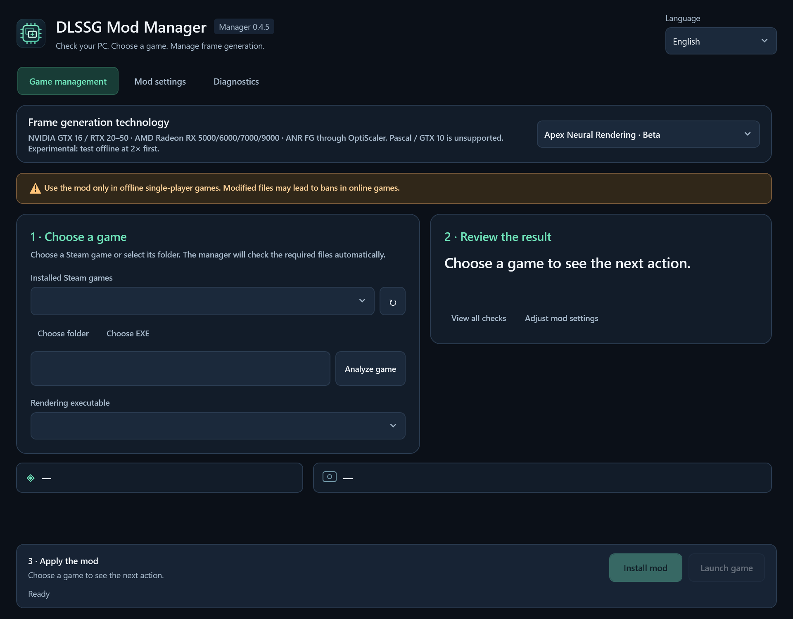

# DLSSG Mod Manager — полное руководство пользователя

**Язык:** [English](../USER_GUIDE.md) · [Italiano](USER_GUIDE.it.md) · [简体中文](USER_GUIDE.zh-Hans.md) · [हिन्दी](USER_GUIDE.hi.md) · [Español](USER_GUIDE.es.md) · [Français](USER_GUIDE.fr.md) · [العربية](USER_GUIDE.ar.md) · [বাংলা](USER_GUIDE.bn.md) · [Português](USER_GUIDE.pt.md) · **Русский** · [اردو](USER_GUIDE.ur.md)

Для **менеджера 0.5.2** в **Windows 10/11 x64**. Язык интерфейса выбирается в правом верхнем углу приложения. Это независимый менеджер исходных проектов, а не официальное приложение NVIDIA, AMD, Intel, ANR или OptiScaler.

**Содержание:** [Быстрый старт](#start) · [Безопасность](#safety) · [Загрузка](#install) · [Выбор технологии](#choose-provider) · [Экран и кнопки](#screen) · [Первая установка](#first-install) · [Проверки](#checks) · [Настройки SM86](#sm86) · [Настройки ANR](#anr) · [Настройки OptiScaler](#optiscaler) · [Настройки в игре](#in-game) · [Проверка результата](#verify) · [Обновления](#updates) · [Отключение и восстановление](#backup) · [Решение проблем](#troubleshooting) · [Файлы и помощь](#files) · [Словарь](#glossary) · [Источники](#sources)

## 1. Быстрый старт: первая проверка

В приложении откройте **Руководство** и нажмите **Начать пошаговое знакомство**, чтобы пройти восемь практических шагов. Ищите по темам, нажимайте **?** рядом с параметром или **F1**, когда его элемент управления находится в фокусе. Кнопка **Показать в менеджере** открывает и выделяет нужные элементы без применения изменений.

1. Закройте игру. Выберите **одиночную игру для работы без сети**.
2. Откройте менеджер и дождитесь окончания проверки пакета выбранной технологии.
3. Выберите технологию, затем игру из Steam либо её папку/EXE. Дождитесь анализа.
4. Прочитайте **2 · Изучите результат**. Полный список находится в **Диагностике**. Устраните все проверки **Заблокировано**; перед продолжением прочитайте предупреждения.
5. В **Настройках мода** оставьте начальные значения: **SM86: DLSS, 2×**; **ANR: Auto, 2×**; **OptiScaler: автоматическое масштабирование, вход и выход FG отключены**.
6. Вернитесь в **Управление играми**. Нажмите **Установить мод**, проверьте папку и настройки в подтверждении и подтвердите. Дождитесь завершения.
7. Запустите игру и выполните [действия для выбранной технологии](#in-game). Немного поиграйте, оценивая движение, интерфейс и отклик управления.
8. Прочитайте журнал в **Диагностике**. Для OptiScaler также нажмите **Insert** в игре и проверьте активный выход. Сам факт загрузки DLL не доказывает успешную генерацию кадров.

После успешной первой проверки меняйте **один параметр за раз**. Закройте игру, примените изменение в менеджере и перезапустите игру перед сравнением.

## 2. Прочитайте перед изменением игры

**Используйте эти моды только в одиночных играх без сети. Изменённые файлы могут вызвать срабатывание античита или блокировку аккаунта.** Менеджер не обходит античит и не защищает от блокировок. Режим без сети не гарантирует отсутствия античита; обнаруженный античит всё равно блокирует установку.

Менеджер проверяет файлы и необходимые условия. **«Требования обнаружены» не гарантирует совместимость в игре, стабильность или прирост FPS.** Сохраняйте обычные резервные копии важных сохранений: копии менеджера относятся к изменяемым им файлам игры, а не ко всем сохранениям или всей игре.

Не добавляйте загрузчики вручную поверх других, не заменяйте игровые файлы случайными DLL и не удаляйте конфликтующий файл только ради успешной проверки. Сначала разберитесь с установленным модом. Бинарные файлы загружаются из исходных репозиториев как данные; менеджер не запускает их установочные скрипты.

## 3. Загрузка и запуск менеджера

Используйте [официальные выпуски менеджера](https://github.com/VenomDrake/DLSSG-Mod-Manager/releases/latest).

| Загрузка | Что делать |
|---|---|
| **Портативный ZIP** | Распакуйте **весь ZIP** в папку с правом записи и запустите `DLSSGModManager.exe`. Не запускайте его внутри архива. Храните лицензии и документацию вместе с программой. |
| **Установщик Windows (.msi)** | Закройте менеджер и запустите MSI. Он устанавливает программу для вашего пользователя Windows и создаёт ярлыки. |

Опубликованные пакеты включают среду .NET менеджера. Отдельно устанавливать Python, CUDA Toolkit или программу распаковки не нужно. Для выбранной технологии могут потребоваться графический драйвер, Visual C++ или компоненты Vulkan; это отдельные проверки.

Менеджер и MSI не имеют цифровой подписи. Загружайте только нужные выпуски проекта; не отключайте защиту Windows целиком. При первом запуске интернет нужен для получения пакета технологии. Позже проверенный локальный пакет может использоваться без сети, но **наличие локального пакета не подтверждает, что это последняя версия**.

## 4. Какую технологию выбрать?

Выбор находится в разделе **Масштабирование и генерация кадров**. В руководстве технология также называется **провайдером**.

| Вариант | Назначение и требования для первой проверки |
|---|---|
| **DLSSG for SM86 · NVIDIA / XeSS** | Проверенный путь менеджера для NVIDIA **RTX 20/30**, драйвера **R580 или новее**, настроенного аппаратного планирования GPU (HAGS) и поддерживаемой встроенной библиотеки DLSS Frame Generation игры. Игра должна использовать DirectX 12. Начните с DLSS и 2×. |
| **Apex Neural Rendering · Бета** | Альтернативный провайдер FG для заявленных менеджером семейств **GTX 16 / RTX 20–50** и **Radeon RX 5000/6000/7000/9000**. Нужны встроенный x64 DLSS Frame Generation через DX12/Vulkan, Visual C++ x64 и загрузчик Vulkan. GTX 10/Pascal и Intel Arc не входят в поддержку ANR этим менеджером. Начните с Auto и 2×. Сам ANR остаётся бета-версией. |
| **OptiScaler · Масштабирование / FG** | Заменяет совместимое временное масштабирование DLSS/FSR/XeSS игры и управляет поддерживаемыми путями FG. Для одного только масштабирования встроенный DLSS Frame Generation **не требуется**. NVIDIA, AMD и Intel рассматриваются как кандидаты, но у каждого выхода свои ограничения. Начните с Auto и **выключенного входа/выхода FG**. |

HAGS и NVIDIA R580 **не являются общими требованиями**, автоматически распространяющимися на ANR или OptiScaler. Для **выхода DLSS** в OptiScaler всё равно нужны NVIDIA RTX и библиотека DLSS игры. OptiScaler не делает любой алгоритм совместимым с любой видеокартой.

Менеджером 0.5.2 проверены схемы **SM86 0.4.1/0.4.2**, **ANR FG-V.B15/B17** и **OptiScaler 0.9.5**. Более новый пакет исходного проекта может оставаться заблокированным, пока его изменившиеся требования не проверены.

Менеджер запоминает выбранную технологию и **не подбирает лучшую автоматически** по видеокарте. Перед выводом о неподдерживаемом GPU выберите подходящую технологию.

## 5. Экран и все основные кнопки

Вкладка **Руководство** содержит это полное руководство без подключения к сети, с выбором тем и поиском. Пошаговое знакомство остаётся рядом с менеджером: **Назад** и **Далее** переключают восемь шагов, **Прочитать полное объяснение** открывает нужную тему, а **Закрыть пошаговое знакомство** завершает знакомство. Переход вперёд не отмечает проверки совместимости как пройденные; установка по-прежнему требует обычной проверки и подтверждения.

| Область или элемент | Что делает |
|---|---|
| **Версия менеджера** | Версия программы, отдельная от версии пакета выбранного мода. |
| **Язык** | Меняет язык интерфейса. Арабский и урду отображаются справа налево. Значения конфигурации вроде `dxgi.dll` сохраняют исходное написание. |
| **Выбор технологии** | Выбирает SM86, ANR или OptiScaler. При смене заново проверяются пакет и требования провайдера; файлы игры сразу не изменяются. |
| **Управление играми** | Выбор игры, просмотр результата и применение мода. |
| **Настройки мода** | Изменение параметров выбранного провайдера. Само изменение поля ничего не записывает в игру. |
| **Диагностика** | Все проверки, сведения о пакете и ПК, журналы, ссылки на драйверы, экспорт отчёта, отключение и восстановление. |
| **Установленные игры Steam / ↻** | Выбор найденной игры Steam; ↻ обновляет библиотеки. Наличие игры в Steam не означает поддержку мода. |
| **Выбрать папку / Выбрать EXE** | Ручной выбор игры, в том числе не из Steam. Нужен настоящий исполняемый файл рендеринга, а не лаунчер, обработчик сбоев или установщик. |
| **Поле пути / Проверить игру** | Можно вставить путь папки/EXE и запустить анализ. Изменение пути очищает прежний результат, чтобы он не использовался по ошибке. |
| **Исполняемый файл рендеринга** | Позволяет выбрать из нескольких кандидатов. Во многих Unreal-играх это `GameName\Binaries\Win64\...-Win64-Shipping.exe`, а не небольшой лаунчер в основной папке. |
| **Показать все проверки / Изменить настройки мода** | Открывает соответствующую вкладку. |
| **Установить / Обновить / Применить настройки / Сменить технологию** | Одна область действий с подписью по текущей ситуации. Изменения применяются только после проверки условий и подтверждения. |
| **Запустить игру** | Запускает выбранную игру, при совпадении используя Steam. Мод при этом не устанавливается. |
| **Отменить операцию** | Запрашивает безопасную остановку. Дождитесь окончания критического применения или отката. |

В **Диагностике** кнопка **↻** пакета проверяет исходный пакет, а **↻** ПК заново читает оборудование. **Открыть параметры графики Windows** открывает настройки, но не включает HAGS за вас. Кнопки драйверов открывают страницы NVIDIA, AMD или Intel в зависимости от провайдера и обнаруженных адаптеров. **Исходный проект** открывает репозиторий выбранной технологии.

Небольшое уведомление **Обновить и перезапустить** относится к **самому менеджеру**. Его **×** скрывает уведомление об этой версии в текущем окне; ничего не удаляется.

## 6. Установка, изменение настроек и смена технологии

1. Дождитесь загрузки и проверки пакета, выберите правильный EXE рендеринга.
2. Прочитайте итог и полный список проверок. Закройте игру и оставшиеся процессы игры.
3. Оставьте начальные настройки или задайте нужные. Результат может измениться, если параметр добавляет новое требование.
4. Нажмите основную кнопку внизу. В подтверждении проверьте технологию, папку рендеринга, версию и параметры.
5. Подтвердите. Менеджер подготавливает проверенные файлы, создаёт резервную копию, отключает старые загрузчики, меняет данные и последним активирует новый загрузчик. Дождитесь завершения.
6. Перезапустите игру. Уже открытая игра не может надёжно использовать только что записанные настройки.

**«У вас уже последняя версия» относится к идентичности установленного пакета.** Это не значит, что только что изменённый параметр уже применён. Закройте игру и нажмите **Применить настройки**.

Для управляемой установки смена провайдера использует ту же систему резервных копий и истории. Отдельный OptiScaler 0.9.5 и специальный загрузчик OptiScaler из ANR различаются; менеджер не смешивает их. Перед сменой с внешнего ANR Addon может потребоваться восстановить внешнюю установку. Неизвестные ручные установки защищаются, а не заменяются без предупреждения.

## 7. Как читать проверки

| Статус | Значение и действие |
|---|---|
| **Пройдено** | Успешна именно эта проверка. Остальные требования и работа игры этим не подтверждаются. |
| **Информация** | Сведения об условии, настройке или необязательном компоненте. Прочитайте при необходимости. |
| **Предупреждение / Требует проверки** | Нужны внимание или подтверждение в игре. Статус не блокирует автоматически, но и не гарантирует безопасность или совместимость. |
| **Неизвестно** | Менеджер не смог установить факт. Прочитайте подробности, не считайте проверку успешной. |
| **Заблокировано** | Установка невозможна до устранения причины. |

Обычно проверяются Windows/x64, GPU и драйвер, HAGS там, где он нужен, Visual C++/Vulkan, идентичность и структура пакета, полнота сканирования и доступ, правильный EXE, встроенный вход/библиотека, признаки графического API, античит, существующие или изменённые загрузчики, запущенная игра, доступность записи и свободное место. Резервным копиям и подготовке нужно больше места, чем занимает готовый мод.

**Не поддерживается** означает обнаруженное техническое несоответствие. **Требует проверки** означает неполные данные, неоднозначный EXE или, например, встроенный в игру вход без отдельной DLL. **Установка заблокирована** может означать конфликт или проблему пакета, а не неподдерживаемую игру. Сканирование файлов не доказывает отсутствия античита и не гарантирует работу игры.

## 8. SM86: все настройки менеджера

**Для первой проверки:** DLSS, 2×, оптимизация 1, предустановка A, переопределение SR отключено, журнал 2, запись времени кадров выключена, `version.dll`.

| Настройка | Простое объяснение и варианты |
|---|---|
| **Движок генерации** | **NVIDIA DLSS-G** или **Intel XeSS-FG** выбирает реализацию генерации мода. XeSS здесь — реализация SM86, а не обещание общей поддержки видеокарт Intel. Начните с DLSS. |
| **Множитель кадров** | DLSS предлагает **2×–6×**, XeSS — **2×–4×**. Это запрос множителя: 2× — один дополнительный кадр на настоящий, 3× — два и так далее. Игра может ограничить значение; неподдерживаемый запрос способен помешать включению FG. Дополнительные кадры не гарантируют пропорционального снижения задержки или плавности. Начните с 2×. |
| **Оптимизация вычислительных ядер** | **0:** исходные ядра для сравнения. **1:** ускорения с точным результатом, рекомендуется. **2:** более быстрая приближённая обработка. **3:** максимальное приближение. Высокие уровни могут менять изображение; сравнивайте движущиеся края и интерфейс, а не выбирайте максимальное число автоматически. Только для DLSS-G. |
| **Предустановка DLSS-G** | **A:** обычный начальный вариант. **B:** пересборка интерфейса, если игра передаёт подходящие буферы без HUD и отдельно UI; создать их эта настройка не может. **C:** облегчённая FG с возможной потерей качества, особенно на HUD и границах перекрываемых объектов. Только для DLSS-G. |
| **Переопределение Super Resolution** | **Off** сохраняет масштабирование игры. **M-INT8 / L-INT8** выбирают INT8-ядра M/L проекта. **M-FP16 / L-FP16** — соответствующую обработку FP16. M/L — варианты модели, а не универсальный рейтинг скорости. В режимах качества, баланса и DLAA переопределение может снизить производительность; для первой проверки оставьте Off. |
| **Оптический поток XeSS** | **Coarse**, **Middle**, **Fine** меняют разрешение обработки потока. Более точная обработка может требовать больше времени GPU. **CoarseAt4K** использует Coarse при числе выходных пикселей не меньше 3840×2160, иначе Middle. Начните с Middle. Только для XeSS-FG. |
| **Обработка интерфейса XeSS** | **Auto**, **Требовать изображение без HUD (1)** или **Не использовать изображение без HUD (0)**. В проверенном SM86 **0.4.2 Auto ведёт себя как 0**: интерполируется всё изображение, включая UI. Для 1 игра должна передавать подходящее изображение без HUD, иначе возможна ошибка. |
| **Подробность журнала** | **0 Выключено**, **1 Ошибки**, **2 Диагностика (рекомендуется)**, **3 Подробная трассировка**. Подробности помогают искать причины, но увеличивают журнал. |
| **Записывать время кадров** | Дополнительные данные времени для диагностики. Не ограничивает FPS и не включает FG. Сначала оставьте выключенным. |
| **Загрузочная DLL** | `version.dll` (рекомендуется), `winmm.dll`, `dbghelp.dll`, `dinput8.dll`, `dxgi.dll`, `d3d12.dll`. Имя определяет способ загрузки мода игрой. Оставляйте один активный загрузчик; если мод не загружается, пробуйте варианты через менеджер. Не добавляйте копии вручную. |

У DLSS-G и XeSS-FG разные параметры. Видимость параметра одного движка не делает его активным при выборе другого.

**HAGS для SM86:** откройте параметры графики Windows из Диагностики, включите аппаратное планирование GPU, если Windows предлагает его, затем перезагрузите Windows. Настроенное значение и реально активная функция — разные проверки. Подтверждение работы берётся из журнала игры. Менеджер не меняет драйвер или HAGS автоматически.

## 9. ANR: все настройки менеджера

**Для первой проверки:** путь Auto, 2×, 80 нит на единицу, обработка смены сцены включена, `dxgi.dll`. Движок — ANR; оптимизация, предустановки и переопределение SR от SM86 не применяются.

| Параметр или режим | Значение |
|---|---|
| **Full / Addon** | Выбирается автоматически. **Full** включает проверенную конфигурацию загрузчика и провайдера. **Addon** добавляет ANR к совместимой внешней установке OptiScaler, сохраняя её загрузчик. При переходе с управляемого отдельного OptiScaler на ANR используется Full. Не выбирайте и не копируйте произвольный addon вручную. |
| **Множитель кадров** | Запрашивает **2×–6×** в пределах интеграции игры. Начните с 2×. Менеджер записывает соответствующее число дополнительных кадров: 6× не означает шесть дополнительных кадров. |
| **Вычислительный путь** | **auto**, **coopmat**, **packed**, **dp4a**, **portable**, **portable-linalg**, **portable-xmx** — разные способы вычислений ANR, а не уровни качества изображения. Auto использует логику выбора провайдера; явные пути требуют подходящих возможностей GPU, не все обязательно работают или быстрее. Оставьте Auto, если не исследуете конкретную проблему. |
| **Яркость HDR** | Значение **40–1000**, по умолчанию **80**: яркость, соответствующая линейному значению 1.0 в обработке HDR/PQ провайдера. Это не ползунок яркости монитора. Сохраняйте 80, если исследование HDR не требует изменения. |
| **Обработка смены сцены** | По умолчанию включена: предотвращает интерполяцию через резкую смену изображения. Для обычной проверки оставьте включённой. |
| **Загрузочная DLL** | `dxgi.dll`, `winmm.dll`, `version.dll`; начните с `dxgi.dll`. В Addon сохраняется внешний загрузчик, и выбор заблокирован. |

Надпись **Beta** относится к исходному ANR, даже если сам менеджер стабилен. ANR нужны проверенные компоненты Visual C++ x64 и загрузчик Vulkan, даже при DX12 в игре. Требование HAGS от SM86 сюда не переносится.

## 10. OptiScaler: все настройки менеджера

**Для первой проверки:** все алгоритмы масштабирования **Auto**, вход FG **Выключено**, выход FG **Выключено**, подмена GPU DXGI **Auto**, журнал **2 · Информация**, загрузчик `dxgi.dll`.

### Выбор масштабирования

**Вход** — технология, выбранная в меню самой игры. **Выход** — алгоритм, который реально запускает OptiScaler. Например, игра может передавать DLSS-вход, а OptiScaler выводить XeSS. Сам выбор DLSS в меню игры ещё не доказывает, что на выходе работает DLSS.

| Поле менеджера | Доступные значения |
|---|---|
| **Масштабирование DirectX 11** | Auto; FSR 2.2 (`fsr22`); FSR 3.1 (`fsr31`); собственный XeSS DX11 (`xess`); XeSS через D3D11on12 (`xess_12`); FSR 2.1/2.2/3.1 через DX12 (`fsr21_12`, `fsr22_12`, `fsr31_12`); DLSS. |
| **Масштабирование DirectX 12** | Auto; XeSS; FSR 2.1; FSR 2.2; FSR 3.1/4; DLSS. |
| **Масштабирование Vulkan** | Auto; собственные FSR 2.1/2.2/3.1/4 в пределах поддержки алгоритма; собственный XeSS; FSR 2.1 или FSR 3.1/4 через DX12 (`fsr21_12`, `fsr31_12`); DLSS. |

Используется поле активного графического API игры. **Auto** следует значениям OptiScaler: это наиболее безопасная отправная точка, а не обещание максимальной скорости. Суффикс `_12` означает взаимодействие через DX12, которое может создавать дополнительные затраты.

Для собственного **XeSS в DX11** нужен Intel Arc; `xess_12` — другой вариант через промежуточный API. Для **выхода DLSS** нужны NVIDIA RTX и x64-библиотека DLSS игры. **FSR 3.1/4** не обещает FSR 4 на любом GPU: активная модель или запасной вариант зависят от алгоритма и оборудования. Проверяйте фактический выход в оверлее; менеджер не принуждает неподдерживаемый FSR 4.

В DX11 собственный `fsr31` — это FSR 3.1; путь FSR 4 использует DX12. Общая подпись «3.1 / 4» не гарантирует собственного FSR 4 для DX11.

### Вход и выход генерации кадров

Для первого теста одного масштабирования оставьте **оба поля выключенными**. Чтобы затем включить FG, выберите совместимые вход **и** выход. Активный режим только в одном поле блокируется.

| Вход FG | Что должна предоставлять игра |
|---|---|
| **Выключено** (`nofg`) | Генерация OptiScaler не запрашивается. Выход тоже выключите. |
| **DLSS Frame Generation** (`dlssg`) | Встроенную DLSS FG с подходящей интеграцией Streamline 2; менеджер проверяет доступные признаки и предупреждает, если подтвердить их нельзя. |
| **DLSS-G · Nukem** (`nukems`) | Встроенную библиотеку DLSS-G. Сочетайте с выходом **Nukem · FSR 3**. |
| **FSR Frame Generation** (`fsrfg`) | Совместимый встроенный источник FSR FG. Одного имени DLL недостаточно для подтверждения интеграции. |
| **Вход масштабирования / OptiFG** (`upscaler`) | Работающий временной вход масштабирования на проверенном пути DX12 OptiFG. Может понадобиться коррекция HUD в исходном оверлее. |
| **FSR 3.0 Frame Generation** (`fsrfg30`) | Совместимый встроенный источник FSR 3.0 FG. |

| Выход FG | Значение |
|---|---|
| **Выключено** | Выхода FG нет. Вход тоже выключите. |
| **AMD FSR Frame Generation** (`fsrfg`) | Совместимый алгоритм FidelityFX FG. Одинаковые версии и функции FSR на всех GPU не гарантируются. |
| **Intel XeSS Frame Generation** (`xefg`) | Требует возможностей GPU алгоритма, в том числе подходящей поддержки DP4a, и соответствующих условий игры/экрана. Одного обнаруженного производителя Intel, AMD или NVIDIA недостаточно. У многокадровой генерации есть дополнительные ограничения исходного проекта. |
| **Nukem · FSR 3** (`nukems`) | Проверенный входящий в пакет путь DLSSG-to-FSR3. Обязателен при выборе входа Nukem. |

Менеджер 0.5.2 блокирует выбранную FG на обнаруженном пути **DX11**. Для обнаруженного **Vulkan** проверенная допустимая пара — **Nukem → Nukem**. Для остальных предложенных путей FG нужен DX12; неопределённый API всё ещё требует подтверждения в игре. Эти настройки не делают неподдерживаемую интеграцию совместимой.

### Остальные параметры и расширенные настройки

| Настройка | Значение |
|---|---|
| **Подмена GPU DXGI: Auto / Вкл. / Выкл.** | Для совместимости меняет идентификатор GPU, сообщаемый через DXGI. Реальная видеокарта не становится мощнее; скорость не гарантируется. Начните с Auto. Это не защита от античита; используйте моды только без сети. |
| **Подробность журнала** | **0 Трассировка**, **1 Отладка**, **2 Информация (рекомендуется)**, **3 Предупреждения**, **4 Ошибки**. В отличие от SM86, **0 не отключает журнал**. Менеджер включает запись в файл для диагностики. |
| **Загрузочная DLL** | `dxgi.dll`, `winmm.dll`, `version.dll`, `d3d12.dll`, `dbghelp.dll`, `wininet.dll`, `winhttp.dll`. Начните с `dxgi.dll`; при необходимости меняйте через менеджер с закрытой игрой. |

Нажмите **Insert** в игре для полного оверлея OptiScaler, дополнительных настроек и информации об активном алгоритме. Эти многочисленные расширенные функции принадлежат OptiScaler; менеджер показывает проверенные общие варианты выше. Сохраните рабочие исходные настройки, меняйте по одному параметру и используйте [официальное руководство](https://github.com/optiscaler/OptiScaler/wiki) для отсутствующих в менеджере функций. Инструкции стабильной 0.9.5 и nightly v10 не взаимозаменяемы.

Применение настроек из менеджера снова записывает выбранные им значения. Если вы изменили те же параметры в оверлее, согласуйте выбор в менеджере перед применением. Не относящиеся к ним настройки INI сохраняются там, где это поддерживается.

## 11. Что выбрать в самой игре

**SM86 или ANR:** после установки включите **NVIDIA DLSS Frame Generation** в игре. Начните с 2×, если меню предлагает его. Перезапустите игру, если меню этого требует. Качество масштабирования — например, Quality или Balanced — выбирается отдельно от FG.

**Первая проверка OptiScaler:** включите совместимое временное масштабирование в игре, оставьте вход/выход FG менеджера выключенными и проверьте активный выход через Insert. Для теста одного масштабирования включать DLSS FG необязательно. Если позже выберете встроенный вход FG, включите соответствующую функцию игры. Для входа Upscaler/OptiFG используйте проверенный путь DX12 и инструкции исходного оверлея.

Серый пункт **2×** может просто означать, что доступен только этот множитель. Это **не доказывает** работу FG. Менеджер не может открыть все множители в меню любой игры. Также подпись в меню игры может описывать вход, тогда как OptiScaler использует другой выход.

Для сравнения используйте одну сцену, разрешение и настройки. Оценивайте движущийся текст, ограды, края персонажей и интерфейс, а также FPS и отклик. Генерируемые/показываемые и действительно отрисованные FPS — разные величины. Большее число показанных кадров не означает удвоенного отклика.

## 12. Диагностика: как узнать результат

После короткого теста нажмите **Прочитать журнал игры** в **Диагностике**. Запуск через менеджер и чтение журнала включают периодическое чтение, пока менеджер открыт. Если результат ожидается, закройте игру и перечитайте завершённый журнал.

| Провайдер | Что может установить менеджер |
|---|---|
| **SM86** | Ищет в соответствующей записанной сессии успешное создание функции FG и её первый расчёт. Одной загрузки мода или наличия функции SR недостаточно. Читайте ошибки и сведения о HAGS/GPU в той сессии. |
| **ANR** | Отличает загрузку и инициализацию от реальных расчётов генерации. Для подтверждения нужна полная сессия с положительным числом сгенерированных расчётов и без ошибок генерации. Счётчики и записанный множитель помогают диагностике. |
| **OptiScaler** | Сообщает о загрузке и ошибках текущей сессии журнала. Загрузка DLL или создание цепочки вывода **не доказывают успешную SR, FG или рост производительности**. Проверьте активный алгоритм, статистику кадров и изображение в оверлее игры. |

Неполный, незавершённый или слишком большой журнал не подтверждает полностью успешную сессию. **Нет ошибок** означает лишь, что в понятой читателем части не найдено ошибок, а не подтверждение FPS или FG. Проверяйте время сессии, чтобы не принять старый тест за текущий. Если GPU несколько, уточните, какой реально использует игра.

## 13. Три разных вида обновления

| Обновление | Как работает |
|---|---|
| **Сам менеджер** | Проверяет стабильные выпуски GitHub при запуске и периодически в открытом состоянии — примерно каждые шесть часов. Небольшое уведомление появляется только для новой стабильной версии. Нажмите **Обновить и перезапустить**: программа скачает и проверит подходящий ZIP/MSI, обновится и перезапустится с вашего согласия. Переоткройте менеджер для немедленной проверки. Обычная проверка игнорирует предварительные выпуски. |
| **Загруженный пакет провайдера** | Проверяется для выбранной технологии при запуске или её выборе; ↻ пакета повторяет проверку. Новый проверенный пакет обновляет локальный кеш, но **не применяется сам к играм**. |
| **Мод в одной игре** | Выберите и проверьте игру, затем нажмите **Обновить мод** после проверок и подтверждения. Другие игры сохраняют прежние установки до отдельного обновления каждой. |

Сравниваются ID выпуска, ID файла и SHA-256, поэтому замена файла с тем же номером версии тоже обнаруживается. **Загружено**, **последняя версия**, **локальный кеш без сети** и **ещё не поддерживается менеджером** — разные результаты. Пакет может пройти проверку целостности, но иметь неизвестную схему установки. Дождитесь менеджера с явной поддержкой; не обходите ограничение ручным копированием DLL.

Менеджеры **0.4.3 и новее** используют переименованный репозиторий. Для **0.4.2 и старше** может потребоваться одно ручное обновление полным актуальным MSI/ZIP. Проблема окна справки/ошибки 1639 в MSI-обновляторе 0.2.0/0.2.1 также требует однократной ручной установки исправленного нового MSI. Сохраняйте тип установки и сначала закрывайте менеджер. Не трогайте игры и папки резервных копий.

## 14. Отключение, включение, восстановление и смена провайдера

**Отключить мод** временно прекращает активацию управляемого мода, но не удаляет его целиком. Обычно менеджер отключает загрузчик и сохраняет данные, библиотеки и копии. Для внешнего ANR Addon восстанавливается выбор внешнего OptiScaler с сохранением его загрузчика.

Чтобы **включить снова**, закройте игру и используйте основное действие Установить/Обновить для выбранного управляемого провайдера.

**Восстановить предыдущее состояние** использует копию, связанную с текущей управляемой установкой, обновлением или сменой технологии. Это не универсальная отмена последней кнопки и не специальная отмена Отключения. В зависимости от истории можно вернуться к старой версии, другому провайдеру, отключённой установке или исходному состоянию без мода. Восстановление исходной копии первой установки может убрать активный управляемый мод. Прочитайте подтверждение.

Предыдущие записи могут вести к более ранним копиям; пока запись существует, повторные восстановления могут продвигаться назад по истории установок. Общего окна истории с повторным применением действий нет. Копии сохраняются; изменённые или неизвестные файлы могут заблокировать восстановление вместо перезаписи.

**Никогда не удаляйте вручную** `.dlssg-manager.json`, `.dlssg-manager.transaction.json` и `.dlssg-manager-backups` ради устранения ошибки. В них сведения о владении файлами и восстановлении. После прерывания закройте игру, сохраните эти файлы и переоткройте менеджер. Журнал используется для восстановления во время файловых операций. Если блокировка остаётся, экспортируйте отчёт и попросите помощи, а не удаляйте и не включайте загрузчики вручную.

## 15. Частые проблемы и разумный следующий шаг

| Что видно | Что делать |
|---|---|
| **Установка недоступна** | Дождитесь операции, выберите настоящий EXE и изучите заблокированные проверки в Диагностике. Сборка только для чтения/предпросмотра не устанавливает моды. Устраняйте причины, а не копируйте файлы вручную. |
| **GPU не поддерживается** | Сначала проверьте выбранную технологию. Менеджер запоминает выбор или использует начальный; лучший вариант для GPU автоматически не подбирается. У ANR и OptiScaler другие требования, чем у SM86. |
| **Игра не поддерживается / Требует проверки** | Прочитайте точную причину. Встроенная FG нужна для SM86/ANR; OptiScaler может требовать подтверждение временного входа SR. Встроенный FSR без отдельной DLL бывает неопределим. Проверьте API и EXE. |
| **Пакет последний, но установка заблокирована** | Целостность/актуальность пакета отдельно от проверенной схемы установки, требований ПК и совместимости игры. Для новой неизвестной схемы нужен обновлённый менеджер и проверка. |
| **Steam пуст или нет игры** | Обновите библиотеки Steam либо вручную выберите папку и настоящий EXE рендеринга. |
| **Несколько EXE** | Выберите настоящий рендерер. У Unreal проверяйте `Binaries\Win64` и кандидата `Shipping.exe`. Не выбирайте лаунчер или обработчик сбоев ради обхода неопределённости. |
| **Игра ещё работает** | Закройте её полностью и дождитесь выхода процесса перед установкой, изменением параметров, сменой или восстановлением. |
| **HAGS настроен, но работа не подтверждена** | Для SM86 перезагрузите Windows после включения HAGS, проверьте игру и прочитайте последний журнал. Запись реестра не доказывает активность HAGS в этой сессии. |
| **Нет Visual C++ / Vulkan** | Используйте официальные установщики Microsoft или производителя GPU, а не сайты с отдельными DLL. ANR нужны проверенные компоненты Visual C++ x64 и загрузчик Vulkan. После установки повторите проверку ПК. |
| **Неизвестный загрузчик, ручной мод или изменённый файл** | Сохраните его. Определите мод и восстановите/удалите его штатным способом либо попросите помощи с отчётом. Менеджер специально защищает чужие файлы; ручной OptiScaler не принимается автоматически под управление. |
| **Нет журнала / только загрузка / серый 2×** | Выполните действия для выбранного провайдера в игре, немного поиграйте и перечитайте полный журнал. Если ничего не загружается, может потребоваться другой загрузчик. Серый 2× и запись только о загрузке не доказывают FG. |
| **Шлейфы, мерцание, рывки или снижение FPS** | Вернитесь к рекомендуемым исходным настройкам. Меняйте по одному параметру, снижайте запрос FG при необходимости и читайте ошибки. Попробуйте отключение/восстановление через менеджер. Самый высокий множитель, точность потока или приближение не обязательно лучше. |
| **Настройки не влияют** | Закройте игру, примените настройки и перезапустите. Проверьте выбранный движок и активный API: параметры другого движка/API могут не использоваться. |
| **Операция прервана или восстановление заблокировано** | Держите игру закрытой, сохраните записи и копии. Прочитайте ошибку, экспортируйте отчёт и обратитесь за помощью. Не удаляйте журнал восстановления и не заменяйте копии неизвестными файлами. |
| **Не видно обновления менеджера** | Переоткройте менеджер, проверьте интернет и установленную версию. Обычные проверки игнорируют предварительные выпуски. Очень старым версиям может требоваться описанное выше ручное обновление. |

## 16. Файлы, приватность и обращение за помощью

Обычно настройки программы, кеш и `application.log` находятся в `%LOCALAPPDATA%\DLSSGModManager`. При собственном каталоге данных или специальном запуске предпросмотра UI путь может отличаться. Запись владения, журнал транзакций и копии игры лежат рядом с её **EXE рендеринга**, а не обязательно рядом с лаунчером.

| Провайдер | Обычный журнал относительно папки рендеринга |
|---|---|
| SM86 | `dlssg_sm86\logs\dlssg_sm86.log` |
| ANR | `OptiScaler\custom\Apex Neural Rendering FG\dlssg\nr_fg-*.log` |
| OptiScaler | `OptiScaler.log` |

В Диагностике нажмите **Экспортировать отчёт диагностики** и выберите место для `DLSSG-diagnostic-report.json`. В него входят версии менеджера, провайдера и пакета, хеш/статус обновления пакета, GPU/драйвер, проверки и доступные данные журнала. Корень выбранной игры и начало пути профиля заменяются на `<GAME>` и `<USER>`; перед публикацией просмотрите файл, поскольку полное удаление любых идентифицирующих строк не гарантируется.

Отчёт сохраняется локально и не отправляется автоматически. Аккаунта и телеметрии нет. В запросе помощи укажите провайдера, игру, версию менеджера, точное сообщение блокировки и изменения. Снимок результата и экспортированный отчёт полезнее фразы «не работает». Не публикуйте токены, пароли и посторонние личные файлы.

## 17. Небольшой словарь

| Термин | Простое значение |
|---|---|
| **Настоящие/базовые FPS** | Кадры, действительно рассчитываемые игрой. |
| **Генерация кадров / FG** | Дополнительные вычисленные приблизительно кадры между настоящими. |
| **Масштабирование / SR** | Восстановление более высокого разрешения из изображения, отрисованного в меньшем. Это отдельная от FG функция. |
| **Вход / выход** | Функция игры, перехватываемая OptiScaler / алгоритм, который OptiScaler запускает вместо неё. |
| **API: DX11, DX12, Vulkan** | Графический интерфейс игры. Для разных API поддерживаются разные пути. |
| **HUD / без HUD** | Экранный интерфейс / изображение игры без этого интерфейса. |
| **DLL / загрузчик / прокси** | Библиотека кода и файл с определённым именем, через который игра загружает мод. Имя важно. |
| **HAGS** | Аппаратное планирование GPU в Windows. |
| **Среда выполнения / runtime** | Компонент, необходимый функции, например DLL DLSS игры или Visual C++. |
| **Кеш / SHA-256** | Сохранённый загруженный пакет / отпечаток для проверки целостности. Совпадение не подтверждает работу игры и не делает неизвестную схему поддерживаемой. |
| **Резервная копия / журнал** | Предыдущее состояние файлов / сведения для восстановления прерванного изменения. |

## 18. Исходные проекты и дополнительное чтение

- [Загрузки и проект менеджера](https://github.com/VenomDrake/DLSSG-Mod-Manager).
- [DLSSG for SM86](https://github.com/sdli1995/dlssg_for_sm86), sdli1995 и соавторы; [адаптация SM75](https://github.com/Coldwood1026), Coldwood1026.
- [Apex Neural Rendering](https://github.com/apex-compute/ANR), Apex Compute и соавторы.
- [OptiScaler](https://github.com/optiscaler/OptiScaler) и [официальная wiki](https://github.com/optiscaler/OptiScaler/wiki), авторы проекта.
- [Обзор менеджера](README.ru.md) и [уведомления о сторонних компонентах](../../THIRD_PARTY_NOTICES.md).

Руководство описывает **параметры менеджера 0.5.2** и проверенные им схемы провайдеров. Оно не гарантирует совместимость любой игры, не является тестом производительности или полной инструкцией для каждого пункта оверлея исходных проектов. Для расширенных функций только исходного проекта используйте документацию подходящей версии.
