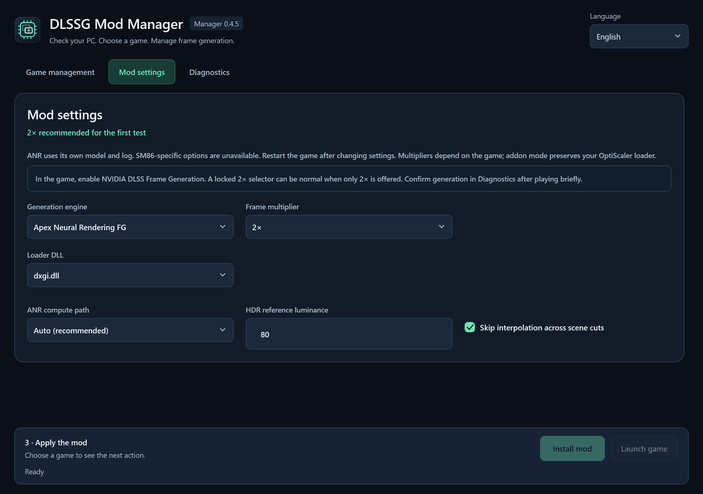

# DLSSG Mod Manager — صارف کے لیے مکمل رہنما

**زبان:** [English](../USER_GUIDE.md) · [Italiano](USER_GUIDE.it.md) · [简体中文](USER_GUIDE.zh-Hans.md) · [हिन्दी](USER_GUIDE.hi.md) · [Español](USER_GUIDE.es.md) · [Français](USER_GUIDE.fr.md) · [العربية](USER_GUIDE.ar.md) · [বাংলা](USER_GUIDE.bn.md) · [Português](USER_GUIDE.pt.md) · [Русский](USER_GUIDE.ru.md) · **اردو**

**Windows 10/11 x64** پر **مینیجر 0.5.2** کے لیے۔ نیچے انگریزی انٹرفیس کے نام دیے گئے ہیں؛ ایپ کے اوپر دائیں جانب اپنی زبان منتخب کریں۔ یہ اصل منصوبوں کا آزاد مینیجر ہے، NVIDIA، AMD، Intel، ANR یا OptiScaler کی سرکاری ایپ نہیں۔

**فہرست:** [فوری آغاز](#start) · [حفاظت](#safety) · [ڈاؤن لوڈ](#install) · [ٹیکنالوجی کا انتخاب](#choose-provider) · [اسکرین اور بٹن](#screen) · [پہلی تنصیب](#first-install) · [جانچیں](#checks) · [SM86 ترتیبات](#sm86) · [ANR ترتیبات](#anr) · [OptiScaler ترتیبات](#optiscaler) · [گیم کی ترتیبات](#in-game) · [تصدیق](#verify) · [اپ ڈیٹس](#updates) · [غیر فعال کرنا اور بحالی](#backup) · [مسائل کا حل](#troubleshooting) · [فائلیں اور مدد](#files) · [اصطلاحات](#glossary) · [ماخذ](#sources)

## 1. فوری آغاز: آپ کا پہلا ٹیسٹ

ایپ میں **رہنما** کھولیں اور آٹھ عملی مراحل کے لیے **رہنمائی کا دورہ شروع کریں** منتخب کریں۔ موضوعات تلاش کریں، ترتیب کے پاس **?** استعمال کریں یا اس کے کنٹرول پر فوکس ہونے کے دوران **F1** دبائیں۔ **مینیجر میں دکھائیں** متعلقہ کنٹرول کھول کر نمایاں کرتا ہے؛ کوئی تبدیلی لاگو نہیں ہوتی۔

1. گیم بند کریں۔ **آف لائن واحد کھلاڑی گیم** منتخب کریں۔
2. مینیجر کھولیں اور منتخب ٹیکنالوجی کے پیکیج کی جانچ مکمل ہونے دیں۔
3. ٹیکنالوجی منتخب کریں، پھر Steam سے گیم یا اس کا فولڈر/EXE چنیں۔ مینیجر کو تجزیہ کرنے دیں۔
4. **2 · نتیجہ دیکھیں (Review the result)** پڑھیں۔ پوری فہرست کے لیے **تشخیص (Diagnostics)** کھولیں۔ ہر **مسدود (Blocked)** جانچ کا سبب حل کریں؛ آگے بڑھنے سے پہلے تنبیہات پڑھیں۔
5. **موڈ کی ترتیبات (Mod settings)** میں پہلے ٹیسٹ کی بنیادی ترتیبات رکھیں: **SM86: DLSS، 2×**؛ **ANR: Auto، 2×**؛ **OptiScaler: خودکار اپ اسکیلنگ، FG اِن پٹ Off اور آؤٹ پٹ Off**۔
6. **گیمز کا انتظام (Game management)** پر لوٹیں۔ **موڈ نصب کریں (Install mod)** چنیں، تصدیق میں ہدف اور ترتیبات دیکھیں، پھر تصدیق کریں۔ تکمیل کا انتظار کریں۔
7. گیم چلائیں اور [منتخب ٹیکنالوجی کے مطابق گیم کے اندر کے مراحل](#in-game) اپنائیں۔ تھوڑی دیر کھیل کر حرکت، HUD اور ردعمل جانچیں۔
8. **تشخیص** میں لاگ پڑھیں۔ OptiScaler کے لیے گیم میں **Insert** بھی دبائیں تاکہ فعال آؤٹ پٹ دیکھ سکیں۔ صرف DLL لوڈ ہونا کامیاب فریم جنریشن کا ثبوت نہیں۔

پہلا ٹیسٹ کامیاب ہونے کے بعد **ایک وقت میں ایک ترتیب** بدلیں۔ مقابلہ کرنے سے پہلے گیم بند کریں، مینیجر سے تبدیلی لاگو کریں اور گیم دوبارہ شروع کریں۔

## 2. گیم میں تبدیلی سے پہلے یہ پڑھیں

**یہ موڈ صرف آف لائن واحد کھلاڑی گیمز میں استعمال کریں۔ بدلی ہوئی گیم فائلیں اینٹی چیٹ کو متحرک کر سکتی ہیں یا پابندی لگوا سکتی ہیں۔** مینیجر اینٹی چیٹ بائی پاس یا پابندی سے تحفظ نہیں دیتا۔ آف لائن ترتیب اینٹی چیٹ کی عدم موجودگی کی ضمانت نہیں؛ اینٹی چیٹ ملنے پر تنصیب پھر بھی روک دی جاتی ہے۔

مینیجر فائلیں اور ضروری شرائط جانچتا ہے۔ **«ضروریات مل گئیں (Requirements detected)» گیم پلے کی مطابقت، استحکام یا FPS بڑھنے کی تصدیق نہیں ہے۔** اہم محفوظ شدہ گیمز کے عام بیک اپ رکھیں؛ مینیجر کے بیک اپ اس کی گیم فائلوں میں تبدیلیوں کے لیے ہیں، تمام محفوظ شدہ گیمز یا پوری گیم کے لیے نہیں۔

لوڈرز دستی طور پر اکٹھے نہ رکھیں، بے ترتیب DLL سے گیم فائلیں تبدیل نہ کریں اور صرف جانچ کامیاب بنانے کے لیے متصادم فائل حذف نہ کریں۔ پہلے موجودہ موڈ کا جائزہ لیں۔ اصل منصوبوں کی بائنری ان کی اصل ریپوزٹریوں سے ڈیٹا کے طور پر ڈاؤن لوڈ ہوتی ہیں؛ مینیجر ان کی سیٹ اپ اسکرپٹ نہیں چلاتا۔

## 3. مینیجر ڈاؤن لوڈ کرکے کھولیں

[مینیجر کی سرکاری ریلیزز](https://github.com/VenomDrake/DLSSG-Mod-Manager/releases/latest) استعمال کریں۔

| ڈاؤن لوڈ | کیا کریں |
|---|---|
| **پورٹیبل ZIP** | **پوری ZIP** ایسے فولڈر میں نکالیں جس میں لکھ سکتے ہوں، پھر `DLSSGModManager.exe` کھولیں۔ ZIP کے اندر سے نہ چلائیں۔ لائسنس اور دستاویزات کی فائلیں ساتھ رکھیں۔ |
| **Windows انسٹالر (.msi)** | مینیجر بند کرکے MSI چلائیں۔ یہ آپ کے Windows صارف کے لیے نصب ہوتا ہے اور شارٹ کٹ بناتا ہے۔ |

شائع شدہ پیکیجز میں مینیجر کا .NET رن ٹائم شامل ہے۔ Python، CUDA Toolkit یا الگ آرکائیو کھولنے والا پروگرام نصب کرنے کی ضرورت نہیں۔ کسی فراہم کنندہ کو پھر بھی گرافکس ڈرائیور، Visual C++ یا Vulkan اجزا چاہییں ہو سکتے ہیں؛ ان کی الگ جانچ ہوتی ہے۔

مینیجر اور MSI پر ڈیجیٹل دستخط نہیں ہیں۔ صرف منصوبے کی وہ ریلیز استعمال کریں جو آپ لینا چاہتے تھے؛ Windows کی حفاظت پورے نظام کے لیے بند نہ کریں۔ پہلی بار فراہم کنندہ کا پیکیج لینے کے لیے انٹرنیٹ چاہیے۔ بعد میں تصدیق شدہ کیش پیکیج آف لائن استعمال ہو سکتا ہے، لیکن **آف لائن کیش تازہ ترین ریلیز ہونے کی تصدیق نہیں**۔

## 4. کون سی ٹیکنالوجی منتخب کروں؟

**اپ اسکیلنگ اور فریم جنریشن (Upscaling and frame generation)** کے تحت منتخب کریں۔ اس رہنما میں ٹیکنالوجی کو **فراہم کنندہ (provider)** بھی کہا گیا ہے۔

| انتخاب | مقصد اور پہلے ٹیسٹ کی ضروریات |
|---|---|
| **DLSSG for SM86 · NVIDIA / XeSS** | NVIDIA **RTX 20/30**، **R580 یا جدید تر** ڈرائیور، ترتیب شدہ ہارڈویئر سے تیز GPU شیڈیولنگ (HAGS) اور گیم کے معاون اصل DLSS Frame Generation رن ٹائم کے لیے مینیجر کا جانچا ہوا طریقہ۔ گیم DirectX 12 استعمال کرتی ہے۔ DLSS اور 2× سے آغاز کریں۔ |
| **Apex Neural Rendering · بیٹا** | مینیجر کی بیان کردہ **GTX 16 / RTX 20–50** اور **Radeon RX 5000/6000/7000/9000** خاندانوں کے لیے متبادل FG فراہم کنندہ۔ گیم میں DX12/Vulkan کے ذریعے اصل x64 DLSS Frame Generation، x64 Visual C++ اور Vulkan لوڈر چاہیے۔ GTX 10/Pascal اور Intel Arc اس مینیجر کی ANR معاونت سے باہر ہیں۔ Auto اور 2× سے آغاز کریں۔ ANR خود ابھی بیٹا ہے۔ |
| **OptiScaler · اپ اسکیلنگ / FG** | موافق گیم کے زمانی DLSS/FSR/XeSS اپ اسکیلر کی جگہ کام کرتا ہے اور معاون FG راستے سنبھال سکتا ہے۔ **صرف اپ اسکیلنگ کے لیے** اصل DLSS Frame Generation **ضروری نہیں**۔ NVIDIA، AMD اور Intel ممکنہ اختیارات ہیں، مگر ہر آؤٹ پٹ کی مزید حدود ہیں۔ Auto اپ اسکیلنگ اور FG **Off/Off** سے آغاز کریں۔ |

HAGS اور NVIDIA R580 ایسی **عالمگیر شرائط نہیں** جو ANR یا OptiScaler کو بھی خود بخود درکار ہوں۔ OptiScaler میں اصل DLSS **آؤٹ پٹ** کو پھر بھی NVIDIA RTX اور گیم کا DLSS رن ٹائم چاہیے۔ OptiScaler ہر GPU پر ہر بیک اینڈ نہیں چلاتا۔

مینیجر 0.5.2 کے جانچے ہوئے تنصیب کے طریقے **SM86 0.4.1/0.4.2**، **ANR FG-V.B15/B17** اور **OptiScaler 0.9.5** ہیں۔ اصل منصوبے کا نیا ڈاؤن لوڈ اپنی بدلی ضروریات کے جائزے تک مسدود رہ سکتا ہے۔

مینیجر منتخب فراہم کنندہ یاد رکھتا ہے؛ وہ آپ کے GPU کے لیے بہترین فراہم کنندہ **خود منتخب نہیں کرتا**۔ GPU جانچ کی ناکامی کا مطلب اخذ کرنے سے پہلے مناسب ٹیکنالوجی چنیں۔

## 5. اسکرین اور ہر اہم بٹن کو سمجھیں

**رہنما** ٹیب میں موضوعات کی فہرست اور تلاش کے ساتھ یہ مکمل رہنما آف لائن دستیاب ہے۔ رہنمائی کا دورہ مینیجر کے ساتھ کھلا رہتا ہے: **واپس** اور **اگلا** آٹھ مراحل کے درمیان لے جاتے ہیں، **مکمل وضاحت پڑھیں** متعلقہ موضوع کھولتا ہے اور **رہنمائی کا دورہ بند کریں** دورہ ختم کرتا ہے۔ آگے بڑھنے سے مطابقت کی جانچ کامیاب شمار نہیں ہوتی؛ تنصیب کے لیے معمول کا جائزہ اور تصدیق پھر بھی ضروری ہے۔

| حصہ یا کنٹرول | اس کا کام |
|---|---|
| **مینیجر کا ورژن (Manager version)** | ایپ کا ورژن۔ منتخب موڈ پیکیج کا ورژن الگ ہے۔ |
| **زبان (Language)** | انٹرفیس کی زبان بدلتا ہے۔ عربی اور اردو میں دائیں سے بائیں ترتیب ہے۔ `dxgi.dll` جیسے ترتیب کے ٹوکن اصل ہجے برقرار رکھتے ہیں۔ |
| **ٹیکنالوجی کا انتخاب (Technology selector)** | SM86، ANR یا OptiScaler چنتا ہے۔ بدلنے پر اس فراہم کنندہ کا پیکیج اور شرائط دوبارہ جانچی جاتی ہیں؛ گیم فوراً تبدیل نہیں ہوتی۔ |
| **گیمز کا انتظام (Game management)** | گیم منتخب کریں، نتیجہ دیکھیں، پھر موڈ لاگو کریں۔ |
| **موڈ کی ترتیبات (Mod settings)** | منتخب فراہم کنندہ کی ترتیبات بدلیں۔ صرف کسی خانے میں تبدیلی گیم میں کچھ نہیں لکھتی۔ |
| **تشخیص (Diagnostics)** | تمام جانچیں، پیکیج/PC تفصیل، لاگ، ڈرائیور روابط، رپورٹ برآمد، غیر فعال کرنا اور بحالی۔ |
| **نصب شدہ Steam گیمز / ↻ (Installed Steam games)** | ملنے والی Steam گیم چنتا ہے؛ ↻ لائبریریاں تازہ کرتا ہے۔ Steam کی فہرست میں ہونا موڈ کی معاونت کا ثبوت نہیں۔ |
| **فولڈر منتخب کریں / EXE منتخب کریں (Choose folder / Choose EXE)** | Steam سے باہر کی گیمز سمیت دستی انتخاب۔ اصل رینڈرنگ EXE چنیں، لانچر، کریش رپورٹر یا انسٹالر نہیں۔ |
| **راستے کا خانہ / گیم کا تجزیہ (Analyse game)** | فولڈر/EXE کا راستہ پیسٹ کرکے تجزیہ کر سکتے ہیں۔ راستہ بدلنے سے پچھلا نتیجہ صاف ہو جاتا ہے تاکہ غلطی سے دوبارہ استعمال نہ ہو۔ |
| **رینڈرنگ اجرائی فائل (Rendering executable)** | کئی ممکنہ فائلوں میں انتخاب کراتا ہے۔ کئی Unreal گیمز میں اوپر کے فولڈر کے چھوٹے لانچر کے بجائے `GameName\Binaries\Win64\...-Win64-Shipping.exe` استعمال کریں۔ |
| **تمام جانچیں دیکھیں / موڈ کی ترتیبات بدلیں (View all checks / Edit mod settings)** | متعلقہ ٹیب کھولتا ہے۔ |
| **نصب / اپ ڈیٹ / ترتیبات لاگو / ٹیکنالوجی بدلیں (Install / Update / Apply settings / Switch technology)** | کام کا ایک ہی حصہ، جس کا نام موجودہ حالت کے مطابق ہوتا ہے۔ تصدیق اور شرائط کے بعد ہی تبدیلی کرتا ہے۔ |
| **گیم شروع کریں (Launch game)** | منتخب گیم چلاتا ہے، مطابقت ملنے پر Steam سے۔ موڈ نصب نہیں کرتا۔ |
| **عمل منسوخ کریں (Cancel operation)** | محفوظ طور پر رکنے کی درخواست دیتا ہے۔ مینیجر کو اہم تبدیلی یا واپسی کا عمل مکمل کرنے دیں۔ |

**تشخیص** میں پیکیج کا **↻** اصل پیکیج جانچتا ہے، جبکہ PC کا **↻** ہارڈویئر دوبارہ پڑھتا ہے۔ **Windows گرافکس کی ترتیبات کھولیں (Open Windows graphics settings)** صرف Windows ترتیبات کھولتا ہے؛ آپ کی طرف سے HAGS فعال نہیں کرتا۔ ڈرائیور بٹن منتخب فراہم کنندہ/اڈاپٹر کے مطابق NVIDIA، AMD یا Intel کے صفحات کھولتے ہیں۔ **اصل منصوبہ (Original project)** اس فراہم کنندہ کی ریپوزٹری کھولتا ہے۔

چھوٹی **اپ ڈیٹ کرکے دوبارہ شروع کریں (Update and restart)** اطلاع **مینیجر خود** سے متعلق ہے۔ اس کا **×** موجودہ ونڈو میں اس ورژن کی اطلاع چھپاتا ہے؛ کچھ اَن انسٹال نہیں کرتا۔

## 6. نصب کریں، ترتیبات یا ٹیکنالوجی بدلیں

1. پیکیج کا ڈاؤن لوڈ/تصدیق مکمل کریں اور درست رینڈرنگ EXE منتخب کریں۔
2. خلاصہ اور تمام جانچیں دیکھیں۔ گیم اور اس کے باقی چلتے عمل بند کریں۔
3. پہلے ٹیسٹ کی بنیادی ترتیبات یا مطلوبہ اختیارات رکھیں۔ کوئی اختیار نئی شرط لائے تو نتیجہ بدل سکتا ہے۔
4. نیچے عمل کا بٹن دبائیں۔ تصدیق میں ٹیکنالوجی، رینڈرنگ فولڈر، ورژن اور ترتیبات پڑھیں۔
5. تصدیق کریں۔ مینیجر تصدیق شدہ فائلیں تیار کرتا ہے، بیک اپ بناتا ہے، پرانے لوڈرز غیر فعال کرتا ہے، ڈیٹا بدلتا ہے اور منتخب لوڈر سب سے آخر میں فعال کرتا ہے۔ مکمل ہونے دیں۔
6. گیم دوبارہ شروع کریں۔ پہلے سے کھلی گیم نئی لکھی ترتیبات قابل اعتماد طور پر استعمال نہیں کر سکتی۔

**«آپ کے پاس پہلے ہی تازہ ترین ورژن ہے (You already have the latest version)» نصب شدہ پیکیج کی شناخت کے بارے میں ہے۔** اس کا مطلب نہیں کہ ابھی بدلی ہوئی ترتیب پہلے ہی لاگو ہو چکی ہے۔ انہیں محفوظ کرنے کے لیے گیم بند رکھ کر **ترتیبات لاگو کریں (Apply settings)** استعمال کریں۔

مینیجر کے زیر انتظام تنصیب میں فراہم کنندہ بدلنے پر یہی بیک اپ/تاریخ کا نظام استعمال ہوتا ہے۔ الگ OptiScaler 0.9.5 اور ANR کا مخصوص OptiScaler لوڈر مختلف ہیں؛ مینیجر انہیں ملاتا نہیں۔ بیرونی ANR Addon سے بدلنے سے پہلے بیرونی تنصیب بحال کرنا پڑ سکتی ہے۔ نامعلوم دستی تنصیبات خاموشی سے بدلنے کے بجائے محفوظ رہتی ہیں۔

## 7. اندازے کے بغیر جانچیں پڑھیں

| حالت | مطلب اور عمل |
|---|---|
| **کامیاب (Passed)** | یہ خاص جانچ کامیاب ہوئی۔ دوسری تمام شرائط یا گیم پلے ثابت نہیں ہوتے۔ |
| **معلومات (Information)** | سیاق، مثلاً ترتیب یا اختیاری جز۔ متعلق ہو تو پڑھیں۔ |
| **تنبیہ / تصدیق درکار (Warning / To verify)** | توجہ یا گیم کے اندر تصدیق چاہیے۔ خود بخود رکاوٹ نہیں؛ آگے بڑھنے کی حفاظت یا مطابقت کا وعدہ بھی نہیں۔ |
| **نامعلوم (Unknown)** | مینیجر حقیقت ثابت نہیں کر سکا۔ کامیاب فرض کرنے کے بجائے تفصیل پڑھیں۔ |
| **مسدود (Blocked)** | سبب حل ہونے تک تنصیب آگے نہیں بڑھ سکتی۔ |

عام جانچوں میں شامل ہیں: Windows/x64، GPU اور ڈرائیور، جہاں ضروری ہو HAGS، Visual C++/Vulkan اجزا، پیکیج کی شناخت اور معاون ساخت، اسکین کی تکمیل/اجازت، درست EXE، اصل اِن پٹ/رن ٹائم، گرافکس API کے شواہد، اینٹی چیٹ نشانیاں، موجودہ یا بدلے لوڈرز، چلتی گیم، صرف پڑھنے والے اہداف اور خالی ڈسک۔ بیک اپ اور فائلیں تیار کرنے کے لیے موڈ کے آخری حجم سے زیادہ جگہ چاہیے۔

**غیر معاون (Unsupported)** ملنے والی تکنیکی عدم مطابقت ظاہر کرتا ہے۔ **جائزہ درکار (Needs review)** کا مطلب شواہد نامکمل، EXE مبہم یا اِن پٹ اندر ضم ہو سکتا ہے۔ **تنصیب مسدود (Installation blocked)** غیر معاون گیم کے بجائے تصادم یا پیکیج مسئلہ بھی ہو سکتا ہے۔ جامد فائل اسکین اینٹی چیٹ کی عدم موجودگی ثابت یا گیم چلنے کی ضمانت نہیں دے سکتا۔

## 8. SM86: مینیجر کی ہر ترتیب

**پہلے ٹیسٹ کی تجویز:** DLSS، 2×، آپٹیمائزیشن 1، پری سیٹ A، SR override Off، لاگ 2، ٹائمنگ بند، `version.dll`۔

| ترتیب | آسان وضاحت اور انتخاب |
|---|---|
| **فریم جنریشن انجن (Frame generation engine)** | **NVIDIA DLSS-G** یا **Intel XeSS-FG** موڈ کا FG نفاذ منتخب کرتا ہے۔ یہاں XeSS، SM86 موڈ کا نفاذ ہے، عام Intel-GPU معاونت کا وعدہ نہیں۔ DLSS سے آغاز کریں۔ |
| **فریم ملٹی پلائر (Frame multiplier)** | DLSS میں **2×–6×**؛ XeSS میں **2×–4×**۔ یہ ملٹی پلائر کی درخواست ہیں: 2× یعنی ہر اصلی فریم پر ایک بنایا ہوا فریم؛ 3× یعنی دو، اسی طرح آگے۔ گیم کم حد عائد کر سکتی ہے اور غیر معاون درخواست FG روک سکتی ہے۔ 2× سے آغاز کریں۔ زیادہ بنے ہوئے فریم کا مطلب اسی تناسب سے کم تاخیر یا زیادہ ہموار کھیل کی ضمانت نہیں۔ |
| **کرنل آپٹیمائزیشن (Kernel optimization)** | **0:** اصل کرنل، موازنے کے لیے مفید۔ **1:** عین اسی آؤٹ پٹ کی تیز کارروائی، تجویز کردہ۔ **2:** تیز تخمینی عمل۔ **3:** زیادہ سے زیادہ تخمینی عمل۔ اونچے درجے نتیجہ بدل سکتے ہیں؛ بڑے عدد کو بہترین ماننے کے بجائے حرکت کرتے کنارے اور UI دیکھیں۔ DLSS-G پر لاگو۔ |
| **DLSS-G پری سیٹ (DLSS-G preset)** | **A:** پہلے ٹیسٹ کا عام انتخاب۔ **B:** گیم مناسب HUD کے بغیر/UI بفر دے تو UI کی دوبارہ ترکیب؛ یہ وہ بفر بنا نہیں سکتا۔ **C:** ہلکا FG، ممکنہ تصویری معیار کی کمی کے ساتھ، خصوصاً HUD/اوٹ کے کناروں پر۔ DLSS-G پر لاگو۔ |
| **سپر ریزولیوشن اووررائیڈ (Super Resolution override)** | **Off** گیم کا اپ اسکیلر برقرار رکھتا ہے۔ **M-INT8 / L-INT8** منصوبے کے M/L INT8 کرنل چنتے ہیں۔ **M-FP16 / L-FP16** متعلقہ FP16 عمل چنتے ہیں۔ M/L ماڈل کے انتخاب ہیں، ہر جگہ کارکردگی کی درجہ بندی نہیں۔ اووررائیڈ Quality، Balanced یا DLAA میں کارکردگی گھٹا سکتے ہیں؛ پہلے ٹیسٹ میں Off رکھیں۔ |
| **XeSS آپٹیکل فلو (XeSS optical flow)** | **Coarse**، **Middle**، **Fine** فلو عمل کی ریزولیوشن بدلتے ہیں۔ زیادہ باریک عمل زیادہ GPU وقت لے سکتا ہے۔ **CoarseAt4K** کم از کم 3840×2160 آؤٹ پٹ پکسلز پر Coarse، ورنہ Middle استعمال کرتا ہے۔ Middle سے آغاز کریں۔ XeSS-FG پر لاگو۔ |
| **XeSS HUD کا انتظام (XeSS HUD handling)** | **Auto**، **HUD کے بغیر تصویر لازم (Require a HUD-less image, 1)** یا **HUD کے بغیر تصویر استعمال نہ کریں (Do not use a HUD-less image, 0)**۔ جانچے گئے SM86 **0.4.2 میں Auto، 0 جیسا کام کرتا ہے**: UI سمیت پوری تصویر کی انٹرپولیشن ہوتی ہے۔ موڈ 1 میں گیم کو مماثل HUD کے بغیر تصویر دینی ہوتی ہے، اس کے بغیر ناکام ہو سکتا ہے۔ |
| **لاگ کی تفصیل (Log detail)** | **0 بند (Off)**، **1 خرابیاں (Errors)**، **2 تشخیص (Diagnostics، تجویز کردہ)**، **3 تفصیلی ٹریس (Detailed traces)**۔ زیادہ تفصیل تشخیص میں مفید ہے مگر لاگ بڑھاتی ہے۔ |
| **فریم کے اوقات ریکارڈ کریں (Record frame timings)** | تحقیق کے لیے اضافی ٹائمنگ ڈیٹا لکھتا ہے۔ FPS حد نہیں لگاتا اور FG فعال نہیں کرتا۔ پہلے ٹیسٹ میں بند رکھیں۔ |
| **لوڈر DLL (Loader DLL)** | `version.dll` (تجویز کردہ)، `winmm.dll`، `dbghelp.dll`، `dinput8.dll`، `dxgi.dll`، `d3d12.dll`۔ فائل کا نام کنٹرول کرتا ہے کہ گیم موڈ کیسے لوڈ کرے۔ ایک فعال لوڈر رکھیں؛ موڈ لوڈ نہ ہو تو مینیجر سے متبادل آزمائیں۔ دستی طور پر کئی کاپیاں اکٹھی نہ رکھیں۔ |

DLSS-G اور XeSS-FG کی ترتیبات مختلف ہیں۔ ایک انجن کا اختیار نظر آنے سے وہ دوسرے انجن کے انتخاب کے دوران فعال نہیں ہو جاتا۔

**SM86 کے لیے HAGS:** تشخیص سے Windows گرافکس ترتیبات کھولیں، جہاں Windows سہولت دے وہاں ہارڈویئر سے تیز GPU شیڈیولنگ فعال کریں، پھر Windows دوبارہ شروع کریں۔ رجسٹری/ترتیب شدہ حالت اور رن ٹائم میں فعال حالت الگ جانچیں ہیں۔ گیم لاگ رن ٹائم کی تصدیق دیتا ہے۔ مینیجر ڈرائیور یا HAGS خودکار طور پر نہیں بدلتا۔

## 9. ANR: مینیجر کی ہر ترتیب

**پہلے ٹیسٹ کی تجویز:** Auto حساب کا راستہ، 2×، فی اکائی 80 نٹس، منظر اچانک بدلنے کا انتظام فعال، `dxgi.dll`۔ انجن ANR ہے؛ SM86 کی آپٹیمائزیشن/پری سیٹ/SR override ترتیبات لاگو نہیں۔

| ترتیب یا موڈ | مطلب |
|---|---|
| **Full / Addon** | خودکار انتخاب۔ **Full** میں جانچا ہوا لوڈر/فراہم کنندہ سیٹ اپ ہوتا ہے۔ **Addon** موافق بیرونی OptiScaler سیٹ اپ میں ANR شامل کرتا اور اس کا لوڈر بچاتا ہے۔ زیر انتظام الگ OptiScaler → ANR تبدیلی Full استعمال کرتی ہے۔ کوئی بھی addon دستی طور پر نہ چنیں یا کاپی کریں۔ |
| **فریم ملٹی پلائر (Frame multiplier)** | گیم کے انضمام کے مطابق **2×–6×** کی درخواست کرتا ہے۔ 2× سے آغاز کریں۔ مینیجر متعلقہ اضافی فریموں کی تعداد لکھتا ہے، 6× کے انتخاب پر چھ اضافی فریم نہیں۔ |
| **حساب کا راستہ (Compute path)** | **auto**، **coopmat**، **packed**، **dp4a**، **portable**، **portable-linalg**، **portable-xmx**، ANR کا حساب کرنے کے متبادل طریقے ہیں۔ یہ تصویری معیار کے درجے نہیں۔ Auto فراہم کنندہ کا انتخابی طریقہ استعمال کرتا ہے؛ مخصوص راستوں کو موزوں GPU صلاحیت چاہیے اور سب کے چلنے یا تیز ہونے کی ضمانت نہیں۔ خاص مسئلہ جانچ نہ رہے ہوں تو Auto رکھیں۔ |
| **HDR حوالہ روشنی (HDR luminance)** | **40–1000**، بنیادی **80**، فراہم کنندہ کی HDR/PQ کارروائی میں خطی قدر 1.0 کے ساتھ وابستہ روشنی بیان کرتا ہے۔ یہ مانیٹر کی چمک کا سلائیڈر نہیں۔ HDR کی خاص تحقیق میں ضرورت نہ ہو تو 80 رکھیں۔ |
| **منظر بدلنے کا انتظام (Scene-cut handling)** | بنیادی طور پر فعال؛ اچانک کٹ کے آر پار انٹرپولیشن سے بچتا ہے۔ عام ٹیسٹ میں فعال رکھیں۔ |
| **لوڈر DLL (Loader DLL)** | `dxgi.dll`، `winmm.dll`، `version.dll`؛ `dxgi.dll` سے آغاز کریں۔ Addon موڈ میں بیرونی لوڈر رہتا ہے اور انتخاب بند ہوتا ہے۔ |

ANR کا **بیٹا (Beta)** نشان اصل فراہم کنندہ کے لیے ہے، چاہے مینیجر مستحکم ریلیز ہو۔ گیم کا گرافکس API DX12 ہونے پر بھی ANR کو جانچے ہوئے Visual C++ x64 اجزا اور Vulkan لوڈر چاہیے۔ اس پر SM86 والی HAGS شرط عائد نہیں۔

## 10. OptiScaler: مینیجر کی ہر ترتیب

**پہلے ٹیسٹ کی تجویز:** تمام اپ اسکیلر **Auto**، FG اِن پٹ **Off**، FG آؤٹ پٹ **Off**، DXGI شناخت کی نقل **Auto**، لاگ **2 · معلومات (Information)**، لوڈر `dxgi.dll`۔

### اپ اسکیلر کے انتخاب

**اِن پٹ** گیم کے اپنے مینو میں منتخب ٹیکنالوجی ہے۔ **آؤٹ پٹ** وہ ہے جو OptiScaler حقیقت میں چلاتا ہے۔ مثلاً گیم DLSS اِن پٹ دے سکتی ہے جبکہ OptiScaler کا آؤٹ پٹ XeSS ہو۔ گیم میں DLSS اِن پٹ منتخب کرنا بذات خود فعال آؤٹ پٹ کے DLSS ہونے کا ثبوت نہیں۔

| مینیجر کا خانہ | دستیاب قدریں |
|---|---|
| **DirectX 11 اپ اسکیلر (DirectX 11 upscaler)** | Auto؛ FSR 2.2 (`fsr22`)؛ FSR 3.1 (`fsr31`)؛ اصل XeSS (`xess`)؛ D3D11on12 کے ذریعے XeSS (`xess_12`)؛ DX12 باہمی عمل کے ذریعے FSR 2.1/2.2/3.1 (`fsr21_12`, `fsr22_12`, `fsr31_12`)؛ DLSS۔ |
| **DirectX 12 اپ اسکیلر (DirectX 12 upscaler)** | Auto؛ XeSS؛ FSR 2.1؛ FSR 2.2؛ FSR 3.1/4؛ DLSS۔ |
| **Vulkan اپ اسکیلر (Vulkan upscaler)** | Auto؛ بیک اینڈ کی معاونت کے مطابق اصل FSR 2.1/2.2/3.1/4؛ اصل XeSS؛ DX12 باہمی عمل کے ذریعے FSR 2.1 یا FSR 3.1/4 (`fsr21_12`, `fsr31_12`)؛ DLSS۔ |

صرف گیم کا فعال API اپنی متعلقہ ترتیب استعمال کرتا ہے۔ **Auto**، OptiScaler کی بنیادی ترتیبات کے مطابق ہے؛ محفوظ ترین آغاز ہے، تیز ترین آؤٹ پٹ کا وعدہ نہیں۔ `_12` کا مطلب DX12 باہمی عمل کا راستہ ہے، جس کا اضافی خرچ ہو سکتا ہے۔

اصل **DX11 XeSS** کو Intel Arc چاہیے؛ `xess_12` مختلف باہمی عمل کا انتخاب ہے۔ **DLSS آؤٹ پٹ** کے لیے NVIDIA RTX اور گیم کا x64 DLSS رن ٹائم ضروری ہے۔ **FSR 3.1/4** ہر GPU پر FSR 4 کا وعدہ نہیں: بیک اینڈ اور ہارڈویئر کی معاونت فعال ماڈل یا متبادل طے کرتی ہے۔ اصل آؤٹ پٹ اوورلے میں دیکھیں؛ مینیجر غیر معاون FSR 4 زبردستی نہیں چلاتا۔

DX11 میں اصل `fsr31` راستہ FSR 3.1 ہے؛ FSR 4 کا راستہ DX12 باہمی عمل استعمال کرتا ہے۔ عمومی «3.1 / 4» نام اصل DX11 FSR 4 کی ضمانت نہیں۔

### فریم جنریشن اِن پٹ اور آؤٹ پٹ

صرف اپ اسکیلنگ کے پہلے ٹیسٹ میں **دونوں خانے Off** رکھیں۔ بعد میں FG کے لیے موافق اِن پٹ **اور** آؤٹ پٹ چنیں؛ صرف ایک کو فعال موڈ میں بدلنا روک دیا جاتا ہے۔

| FG اِن پٹ | گیم کو کیا فراہم کرنا چاہیے |
|---|---|
| **Off** (`nofg`) | OptiScaler FG کی درخواست نہیں۔ آؤٹ پٹ بھی Off رکھیں۔ |
| **DLSS Frame Generation** (`dlssg`) | مناسب Streamline 2 انضمام کے ساتھ اصل DLSS FG؛ مینیجر دستیاب شواہد دیکھتا ہے اور جہاں تصدیق نہ ہو سکے تنبیہ کرتا ہے۔ |
| **DLSS-G · Nukem** (`nukems`) | اصل DLSS-G رن ٹائم۔ اس اِن پٹ کو **Nukem · FSR 3** آؤٹ پٹ سے جوڑیں۔ |
| **FSR Frame Generation** (`fsrfg`) | گیم میں موافق اصل FSR FG ذریعہ۔ صرف DLL کا نام یہ انضمام ثابت نہیں کرتا۔ |
| **اپ اسکیلر اِن پٹ / OptiFG (Upscaler input / OptiFG)** (`upscaler`) | جانچے ہوئے DX12 OptiFG راستے سے کام کرتا زمانی اپ اسکیلر اِن پٹ۔ اصل منصوبے کے اوورلے میں HUD درست کرنے کی ضرورت پڑ سکتی ہے۔ |
| **FSR 3.0 Frame Generation** (`fsrfg30`) | موافق اصل FSR 3.0 FG ذریعہ۔ |

| FG آؤٹ پٹ | مطلب |
|---|---|
| **Off** | FG آؤٹ پٹ نہیں۔ اِن پٹ بھی Off رکھیں۔ |
| **AMD FSR Frame Generation** (`fsrfg`) | موافق FidelityFX FG بیک اینڈ استعمال کرتا ہے۔ ہر GPU پر ایک ہی FSR ورژن/خصوصیات کی ضمانت نہیں۔ |
| **Intel XeSS Frame Generation** (`xefg`) | مناسب DP4a معاونت اور گیم/ڈسپلے کی شرائط سمیت بیک اینڈ کی GPU صلاحیت درکار ہے۔ صرف کمپنی کی شناخت سے ہر Intel، AMD یا NVIDIA آلے کے لیے فعال نہیں ہوتا۔ ملٹی فریم معاونت پر اصل منصوبے کی مزید حدود ہیں۔ |
| **Nukem · FSR 3** (`nukems`) | ساتھ شامل جانچا ہوا DLSSG-to-FSR3 راستہ استعمال کرتا ہے۔ اِن پٹ Nukem ہو تو ضروری ہے۔ |

مینیجر 0.5.2، معلوم **DX11** راستے پر منتخب FG روک دیتا ہے۔ معلوم **Vulkan** راستے پر اس کی جانچی ہوئی اجازت یافتہ FG جوڑی **Nukem → Nukem** ہے۔ دوسرے پیش کردہ FG راستوں کو DX12 چاہیے؛ نامعلوم API شواہد میں پھر بھی گیم کے اندر تصدیق ضروری ہے۔ یہ کنٹرول غیر معاون گیم انضمام کو موافق نہیں بناتے۔

### باقی کنٹرول اور اعلیٰ ترتیبات

| ترتیب | مطلب |
|---|---|
| **DXGI GPU شناخت کی نقل: Auto / On / Off (DXGI GPU spoofing)** | مطابقت کے لیے DXGI سے بتائی جانے والی GPU شناخت بدلتا ہے۔ اصلی GPU کو اپ گریڈ یا کارکردگی کی ضمانت نہیں دیتا۔ آغاز میں Auto رکھیں۔ اینٹی چیٹ سے تحفظ نہیں؛ موڈ صرف آف لائن استعمال کریں۔ |
| **لاگ کی تفصیل (Log detail)** | **0 ٹریس (Trace)**، **1 ڈی بگ (Debug)**، **2 معلومات (Information، تجویز کردہ)**، **3 تنبیہ (Warning)**، **4 خرابی (Error)**۔ SM86 کے برعکس **0 کا مطلب لاگ بند نہیں**۔ مینیجر تشخیص کے لیے فائل لاگ فعال کرتا ہے۔ |
| **لوڈر DLL (Loader DLL)** | `dxgi.dll`، `winmm.dll`، `version.dll`، `d3d12.dll`، `dbghelp.dll`، `wininet.dll`، `winhttp.dll`۔ `dxgi.dll` سے آغاز کریں؛ ضرورت ہو تو گیم بند رکھ کر مینیجر سے بدلیں۔ |

گیم میں **Insert** دبانے سے OptiScaler کا مکمل اصل اوورلے، اعلیٰ ترتیبات اور فعال بیک اینڈ کی معلومات ملتی ہیں۔ اس کے بہت سے اعلیٰ کنٹرول OptiScaler کے ہیں؛ مینیجر اوپر والے جانچے ہوئے عام انتخاب دکھاتا ہے۔ چلتی ہوئی بنیادی حالت رکھیں، ایک وقت میں ایک چیز بدلیں اور اس مینیجر سے باہر کے کنٹرول کے لیے [سرکاری دستی کتاب](https://github.com/optiscaler/OptiScaler/wiki) دیکھیں۔ مستحکم 0.9.5 اور v10 nightly ہدایات ایک دوسرے کی جگہ استعمال نہیں ہوتیں۔

مینیجر سے ترتیبات لاگو کرنے پر اس کی منتخب قدریں دوبارہ لکھی جاتی ہیں۔ اگر وہی اختیارات اوورلے میں بدلے ہوں تو لاگو کرنے سے پہلے مینیجر کا انتخاب موافق رکھیں؛ جہاں معاونت ہو، غیر متعلق INI ترتیبات محفوظ رہتی ہیں۔

## 11. گیم کے اندر کیا منتخب کریں

**SM86 یا ANR:** نصب کرنے کے بعد گیم کا **NVIDIA DLSS Frame Generation** اختیار فعال کریں۔ جہاں گیم اجازت دے 2× سے آغاز کریں۔ مینو مانگے تو گیم دوبارہ شروع کریں۔ Quality یا Balanced جیسا اپ اسکیلنگ معیار FG سے الگ انتخاب ہے۔

**OptiScaler کا پہلا ٹیسٹ:** گیم میں موافق زمانی اپ اسکیلر فعال کریں، مینیجر کا FG اِن پٹ/آؤٹ پٹ Off رکھیں اور Insert سے فعال آؤٹ پٹ دیکھیں۔ صرف اپ اسکیلنگ جانچنے کے لیے DLSS FG فعال کرنا ضروری نہیں۔ بعد میں اصل FG اِن پٹ چنیں تو گیم کی متعلقہ خصوصیت فعال کریں۔ Upscaler/OptiFG اِن پٹ کے لیے جانچا ہوا DX12 راستہ اور اصل اوورلے کی ہدایات استعمال کریں۔

سرمئی **2×** کا سادہ مطلب ہو سکتا ہے کہ صرف یہی ملٹی پلائر دستیاب ہے۔ اس سے FG چلنا **ثابت نہیں ہوتا**۔ مینیجر ہر گیم کے مینو میں ہر ملٹی پلائر نہیں کھول سکتا۔ اسی طرح گیم کے مینو کا نام اِن پٹ بیان کر سکتا ہے، جبکہ OptiScaler مختلف آؤٹ پٹ چلا رہا ہو۔

موازنے کے لیے وہی منظر، ریزولیوشن اور ترتیبات رکھیں۔ FPS اور اِن پٹ ردعمل کے ساتھ حرکت کرتا متن، باڑ، کرداروں کے کنارے اور HUD دیکھیں۔ بنائے/دکھائے گئے FPS اور واقعی رینڈر کیے FPS مختلف ہیں۔ زیادہ دکھائے گئے فریم سے ردعمل دوگنا فرض نہیں کیا جا سکتا۔

## 12. تشخیص: کیسے معلوم ہو کہ کیا ہوا

مختصر ٹیسٹ کے بعد **تشخیص** میں **گیم کا لاگ پڑھیں (Read game log)** چنیں۔ مینیجر سے گیم چلانے اور لاگ پڑھنے سے، مینیجر کھلا رہنے تک وقتاً فوقتاً لاگ پڑھنا شروع ہوتا ہے۔ نتیجہ زیر التوا ہو تو گیم بند کرکے مکمل لاگ دوبارہ پڑھیں۔

| فراہم کنندہ | مینیجر کیا ثابت کر سکتا ہے |
|---|---|
| **SM86** | مماثل ریکارڈ شدہ سیشن میں FG خصوصیت کا کامیابی سے بننا اور پہلا evaluation دیکھتا ہے۔ صرف موڈ لوڈ ہونا یا SR خصوصیت ملنا کافی نہیں۔ خرابیاں اور رن ٹائم HAGS/GPU معلومات پڑھیں۔ |
| **ANR** | لوڈ اور آغاز ہونے کو اصل بنائے گئے فریموں کے evaluations سے الگ کرتا ہے۔ FG تصدیق کے لیے مکمل سیشن، صفر سے زیادہ generated-evaluation گنتی اور کوئی جنریشن خرابی نہ ہونا ضروری ہے۔ گنتی اور ریکارڈ شدہ ملٹی پلائر تشخیص میں مدد کرتے ہیں۔ |
| **OptiScaler** | لوڈ ہونا اور موجودہ سیشن کے لاگ کی خرابیاں بتاتا ہے۔ DLL لوڈ یا swapchain بننا **کامیاب SR، FG یا بہتر کارکردگی کا ثبوت نہیں**۔ گیم کے اوورلے میں فعال بیک اینڈ، فریم کے اعداد اور بصری نتیجہ جانچیں۔ |

جزوی، نامکمل یا بہت بڑا لاگ پورا کامیاب سیشن ثابت نہیں کر سکتا۔ **کوئی خرابی نہیں (No errors)** کا مطلب قاری کے سمجھے گئے حصے میں خرابی نہ ملنا ہے، کارکردگی یا FG کی سند نہیں۔ دکھایا گیا سیشن وقت دیکھیں تاکہ پرانے ٹیسٹ کو موجودہ نہ سمجھیں۔ کئی GPU والے PC میں دیکھیں گیم حقیقت میں کون سا اڈاپٹر استعمال کرتی ہے۔

## 13. تین مختلف چیزیں اپ ڈیٹ ہو سکتی ہیں

| اپ ڈیٹ | طریقہ |
|---|---|
| **مینیجر ایپ** | شروع ہوتے وقت اور کھلے رہنے پر وقتاً فوقتاً (تقریباً ہر چھ گھنٹے) مستحکم GitHub ریلیزز دیکھتا ہے۔ چھوٹی اطلاع صرف نئے مستحکم ورژن پر آتی ہے۔ **اپ ڈیٹ کرکے دوبارہ شروع کریں (Update and restart)** چنیں؛ آپ کی رضامندی سے درست پورٹیبل/MSI پیکیج ڈاؤن لوڈ و تصدیق کرکے اپ ڈیٹ اور دوبارہ شروع کرتا ہے۔ فوری جانچ کے لیے مینیجر دوبارہ کھولیں۔ عام مستحکم جانچ پری ریلیزز کو نظر انداز کرتی ہے۔ |
| **ڈاؤن لوڈ شدہ فراہم کنندہ پیکیج** | آغاز پر یا منتخب کرنے کے بعد متعلقہ فراہم کنندہ کی جانچ؛ پیکیج ↻ دوبارہ جانچتا ہے۔ نیا تصدیق شدہ ڈاؤن لوڈ کیش بدلتا ہے۔ گیمز میں خود **لاگو نہیں ہوتا**۔ |
| **ایک گیم کا موڈ** | گیم چن کر تجزیہ کریں اور جانچوں و تصدیق کے بعد **موڈ اپ ڈیٹ کریں (Update mod)** چنیں۔ دوسری گیمز کی موجودہ تنصیب تب تک رہتی ہے جب تک انہیں الگ الگ اپ ڈیٹ نہ کریں۔ |

مینیجر ریلیز ID، اثاثے کی ID اور SHA-256 ملاتا ہے، اس لیے ایک ہی نظر آنے والے ورژن کے بدلے اثاثے بھی پہچان سکتا ہے۔ **ڈاؤن لوڈ شدہ (Downloaded)**، **تازہ ترین (up to date)**، **آف لائن کیش (offline cache)** اور **اس مینیجر میں ابھی غیر معاون (not yet supported by this manager)** الگ نتائج ہیں۔ پیکیج ڈاؤن لوڈ کی سالمیت میں کامیاب مگر نامعلوم تنصیب کے طریقے والا ہو سکتا ہے۔ واضح معاونت والے مینیجر ورژن کا انتظار کریں؛ DLL ہاتھ سے کاپی کرکے مجبور نہ کریں۔

مینیجر **0.4.3 اور بعد کے** ورژن نئے نام کی ریپوزٹری استعمال کرتے ہیں۔ بہت پرانے **0.4.2 یا اس سے پہلے** ورژن کو تازہ ترین مکمل MSI/پورٹیبل سے ایک بار دستی اپ ڈیٹ چاہیے ہو سکتی ہے۔ 0.2.0/0.2.1 MSI اپ ڈیٹر کی مدد ونڈو/خرابی-1639 کے لیے بھی درست شدہ نئے MSI کی ایک بار دستی تنصیب چاہیے۔ وہی تنصیب کی قسم رکھیں اور پہلے مینیجر بند کریں۔ گیمز اور بیک اپ فولڈر برقرار رکھیں۔

## 14. غیر فعال، دوبارہ فعال، بحال اور فراہم کنندہ تبدیل کرنا

**موڈ غیر فعال کریں (Disable mod)** زیر انتظام موڈ کو عارضی طور پر فعال ہونے سے روکتا ہے؛ مکمل اَن انسٹال نہیں۔ عموماً مینیجر اپنا لوڈر بند کرتا اور رن ٹائم فائلیں و بیک اپ رکھتا ہے۔ ANR بیرونی Addon میں بیرونی لوڈر برقرار رکھتے ہوئے بیرونی OptiScaler انتخاب واپس لاتا ہے۔

**دوبارہ فعال** کرنے کے لیے گیم بند رکھیں اور منتخب زیر انتظام فراہم کنندہ کے لیے مرکزی Install/Update عمل دوبارہ کریں۔

**پچھلی حالت بحال کریں (Restore previous state)** موجودہ زیر انتظام تنصیب/اپ ڈیٹ/فراہم کنندہ تبدیلی سے متعلق بیک اپ بحال کرتا ہے۔ یہ عام «آخری بٹن کا کام واپس کریں» حکم یا Disable کو خاص طور پر واپس کرنے کا اختیار نہیں۔ تاریخ کے مطابق یہ پرانا موڈ ورژن، دوسرا فراہم کنندہ، غیر فعال تنصیب یا اصل غیر تبدیل شدہ حالت لا سکتا ہے۔ پہلی تنصیب کا اصل بیک اپ بحال کرنے سے فعال زیر انتظام موڈ ہٹ سکتا ہے۔ تصدیق پڑھیں۔

پرانے تنصیب ریکارڈ پہلے کے بیک اپ تک لے جا سکتے ہیں، اس لیے ریکارڈ موجود رہنے تک مزید بحالیاں تاریخ میں مزید پیچھے جا سکتی ہیں۔ عام redo-history براؤزر نہیں ہے۔ بیک اپ رکھے جاتے ہیں؛ بدلی یا نامعلوم فائلیں اووررائٹ ہونے کے بجائے بحالی روک سکتی ہیں۔

خرابی صاف کرنے کے لیے `.dlssg-manager.json`، `.dlssg-manager.transaction.json` یا `.dlssg-manager-backups` **کبھی دستی طور پر حذف نہ کریں**۔ یہ ملکیت اور بازیابی کی معلومات رکھتے ہیں۔ عمل درمیان میں رک جائے تو گیم بند رکھیں، یہ فائلیں بچائیں اور مینیجر دوبارہ کھولیں۔ فائل کے کام کے دوران بازیابی جریدہ استعمال کرتی ہے۔ رکاوٹ برقرار ہو تو رپورٹ برآمد کرکے مدد لیں، لوڈرز دستی طور پر دوبارہ فعال یا حذف نہ کریں۔

## 15. عام مسائل اور اگلا معقول قدم

| کیا دکھتا ہے | کیا کریں |
|---|---|
| **تنصیب بند (Install is disabled)** | جاری عمل کا انتظار کریں، اصل EXE چنیں اور تشخیص کی Blocked جانچیں دیکھیں۔ صرف مطالعہ/UI-preview بلڈ نصب نہیں کر سکتا۔ دستی فائل کاپی کے بجائے وجوہ حل کریں۔ |
| **GPU غیر معاون (GPU unsupported)** | پہلے منتخب فراہم کنندہ دیکھیں۔ مینیجر فراہم کنندہ یاد رکھتا/بنیادی چنتا ہے؛ GPU کے لیے بہترین خود نہیں چنتا۔ ANR اور OptiScaler کی شرائط SM86 سے مختلف ہیں۔ |
| **گیم غیر معاون / جائزہ درکار (Game unsupported / Needs review)** | عین وجہ پڑھیں۔ اصل FG نہ ہونا SM86/ANR کے لیے اہم ہے؛ OptiScaler کو اس کے بجائے زمانی SR اِن پٹ کا ثبوت چاہیے ہو سکتا ہے۔ اندر ضم FSR اِن پٹ غیر فیصلہ کن ہو سکتا ہے۔ گیم کا API اور EXE دیکھیں۔ |
| **تازہ ترین پیکیج مگر تنصیب مسدود** | سالمیت/تازہ ترین ورژن کا نتیجہ، جانچے طریقے اور ہارڈویئر/گیم مطابقت سے الگ ہے۔ نئے نامعلوم طریقے کے لیے مینیجر اپ ڈیٹ/جائزہ چاہیے۔ |
| **Steam فہرست خالی یا گیم غائب** | Steam لائبریریاں تازہ کریں؛ ورنہ فولڈر یا اصل رینڈرنگ EXE دستی طور پر چنیں۔ |
| **کئی EXE** | اصل رینڈرر چنیں۔ Unreal میں `Binaries\Win64` اور `Shipping.exe` امیدوار دیکھیں۔ ابہام سے بچنے کو لانچر یا کریش رپورٹر نہ چنیں۔ |
| **گیم ابھی چل رہی ہے** | مکمل بند کرکے اس کے عمل کے ختم ہونے کا انتظار کریں، پھر تنصیب، ترتیب تبدیلی، فراہم کنندہ تبدیلی یا بحالی کریں۔ |
| **HAGS ترتیب شدہ مگر رن ٹائم غیر مصدقہ** | SM86 کے لیے HAGS فعال کرنے کے بعد Windows دوبارہ شروع کریں، گیم جانچ کر تازہ ترین لاگ پڑھیں۔ صرف رجسٹری ترتیب اس سیشن میں HAGS فعال ہونے کا ثبوت نہیں۔ |
| **Visual C++ / Vulkan غائب** | سرکاری Microsoft یا GPU ساز کے انسٹالر استعمال کریں، DLL ڈاؤن لوڈ سائٹ نہیں۔ ANR کو جانچے ہوئے x64 Visual C++ اجزا اور Vulkan لوڈر دونوں چاہیے۔ پھر ہارڈویئر دوبارہ جانچیں۔ |
| **نامعلوم لوڈر، دستی موڈ یا بدلی فائل** | محفوظ رکھیں۔ اصل موڈ پہچان کر اس کے معاون طریقے سے بحال/ہٹائیں، یا رپورٹ کے ساتھ مشورہ لیں۔ مینیجر جان بوجھ کر بیرونی فائلیں بچاتا ہے؛ دستی OptiScaler خاموشی سے اختیار نہیں کرتا۔ |
| **لاگ نہیں / صرف لوڈ / 2× سرمئی** | گیم کے درست مراحل اپنائیں، مختصر ٹیسٹ کرکے مکمل لاگ دوبارہ پڑھیں۔ کچھ لوڈ نہ ہو تو دوسرا لوڈر چاہیے ہو سکتا ہے۔ سرمئی 2× اور صرف لوڈ کے لاگ FG کا ثبوت نہیں۔ |
| **سائے، جھلملاہٹ، اٹکنا یا کم FPS** | تجویز کردہ بنیادی حالت پر لوٹیں۔ ایک وقت میں ایک تبدیلی کا مقابلہ کریں، جہاں مناسب ہو FG درخواست کم کریں اور خرابیاں دیکھیں۔ مینیجر سے غیر فعال/بحال آزمائیں۔ سب سے بڑے ملٹی پلائر، باریک ترین فلو یا تخمینی درجے کو بہترین نہ سمجھیں۔ |
| **بدلی ترتیبات کا اثر نہیں** | گیم بند کرکے Apply settings کریں، پھر دوبارہ چلائیں۔ منتخب انجن اور فعال API دیکھیں: دوسرے انجن/API کی ترتیب غیر متعلق ہو سکتی ہے۔ |
| **عمل رکا یا بحالی مسدود** | گیم بند اور ریکارڈ/بیک اپ محفوظ رکھیں۔ خرابی پڑھ کر رپورٹ برآمد کریں اور مدد لیں۔ بازیابی جریدہ حذف یا بیک اپ پر نامعلوم فائل زبردستی نہ لکھیں۔ |
| **مینیجر اپ ڈیٹ نظر نہیں آتا** | مینیجر دوبارہ کھولیں، انٹرنیٹ اور نصب ورژن دیکھیں۔ عام جانچ پری ریلیز نظر انداز کرتی ہے۔ بہت پرانی تنصیب کو اوپر والی ایک بار کی دستی اپ ڈیٹ چاہیے ہو سکتی ہے۔ |

## 16. فائلیں، رازداری اور مدد مانگنا

عام ایپ ترجیحات، کیش اور `application.log`، `%LOCALAPPDATA%\DLSSGModManager` میں ہیں۔ مخصوص ڈیٹا ڈائریکٹری یا مخصوص UI-preview آغاز دوسری جگہ استعمال کر سکتا ہے۔ منتخب گیم کا ملکیت ریکارڈ، لین دین جریدہ اور بیک اپ اس کے **رینڈرنگ EXE** کے ساتھ ہوتے ہیں، ضروری نہیں لانچر کے ساتھ ہوں۔

| فراہم کنندہ | رینڈرنگ فولڈر کے لحاظ سے عام گیم لاگ کا مقام |
|---|---|
| SM86 | `dlssg_sm86\logs\dlssg_sm86.log` |
| ANR | `OptiScaler\custom\Apex Neural Rendering FG\dlssg\nr_fg-*.log` |
| OptiScaler | `OptiScaler.log` |

تشخیص میں **تشخیصی رپورٹ برآمد کریں (Export diagnostic report)** استعمال کرکے `DLSSG-diagnostic-report.json` رکھنے کی جگہ چنیں۔ اس میں مینیجر/فراہم کنندہ/پیکیج ورژن، پیکیج ہیش/اپ ڈیٹ حالت، GPU/ڈرائیور تفصیل، جانچیں اور دستیاب لاگ شواہد ہوتے ہیں۔ منتخب گیم کے بنیادی راستے اور صارف پروفائل کے ابتدائی حصے کو `<GAME>` اور `<USER>` جیسے متبادل ناموں سے بدلتا ہے؛ بانٹنے سے پہلے فائل دیکھیں کیونکہ ہر ممکن شناختی عبارت ہٹنے کی ضمانت نہیں۔

رپورٹ مقامی طور پر محفوظ ہوتی ہے، خود بخود بھیجی نہیں جاتی۔ اکاؤنٹ یا ٹیلی میٹری نہیں۔ مدد مانگتے وقت فراہم کنندہ، گیم، مینیجر ورژن، رکاوٹ کا عین پیغام اور اپنی تبدیلیاں بتائیں۔ نتیجے کا اسکرین شاٹ اور برآمد رپورٹ، «کام نہیں کرتا» سے زیادہ مفید ہیں۔ ٹوکن، پاس ورڈ یا غیر متعلق ذاتی فائلیں شیئر نہ کریں۔

## 17. مختصر اصطلاحات

| لفظ | آسان مطلب |
|---|---|
| **رینڈر/بنیادی FPS (Rendered/base FPS)** | گیم کے حساب کیے حقیقی فریم۔ |
| **فریم جنریشن / FG** | حقیقی فریموں کے درمیان داخل اضافی اندازاً بنے فریم۔ |
| **اپ اسکیلنگ / SR** | کم ریزولیوشن رینڈر سے زیادہ ریزولیوشن تصویر کی تعمیر۔ FG سے الگ ہے۔ |
| **اِن پٹ / آؤٹ پٹ** | گیم کی وہ خصوصیت جسے OptiScaler درمیان میں لیتا ہے / اس کی جگہ چلنے والا بیک اینڈ۔ |
| **API: DX11, DX12, Vulkan** | گیم کا گرافکس انٹرفیس۔ مختلف API کے معاون راستے مختلف ہیں۔ |
| **HUD / HUD-less** | اسکرین پر انٹرفیس / اس انٹرفیس کے بغیر گیم کی تصویر۔ |
| **DLL / لوڈر / پراکسی** | کوڈ لائبریری اور نام والی فائل جس سے گیم موڈ لوڈ کرتی ہے۔ فائل کا نام اہم ہے۔ |
| **HAGS** | Windows کی ہارڈویئر سے تیز GPU شیڈیولنگ۔ |
| **رن ٹائم (Runtime)** | کسی خصوصیت کا درکار سافٹ ویئر جز، مثلاً گیم کی DLSS DLL یا Visual C++۔ |
| **کیش / SHA-256** | محفوظ ڈاؤن لوڈ پیکیج / فائل کی سالمیت جانچنے کا نشان۔ نشان ملنا گیم پلے کی تصدیق یا نامعلوم طریقے کو معاون نہیں بناتا۔ |
| **بیک اپ / جریدہ (Backup / journal)** | فائل کی محفوظ سابقہ حالت / درمیان میں رکی تبدیلی بحال کرنے کی معلومات۔ |

## 18. اصل منصوبے اور مزید مطالعہ

- [مینیجر ڈاؤن لوڈ اور منصوبہ](https://github.com/VenomDrake/DLSSG-Mod-Manager)۔
- [DLSSG for SM86](https://github.com/sdli1995/dlssg_for_sm86)، از sdli1995 اور معاونین؛ [SM75 موافقت](https://github.com/Coldwood1026)، از Coldwood1026۔
- [Apex Neural Rendering](https://github.com/apex-compute/ANR)، از Apex Compute اور معاونین۔
- [OptiScaler](https://github.com/optiscaler/OptiScaler) اور اس کی [سرکاری وکی](https://github.com/optiscaler/OptiScaler/wiki)، اس کے معاونین کی طرف سے۔
- [مینیجر کا تعارف](README.ur.md) اور [تیسرے فریق کے نوٹس](../../THIRD_PARTY_NOTICES.md)۔

یہ رہنما **مینیجر 0.5.2 میں دستیاب کنٹرول** اور اس کے جانچے ہوئے فراہم کنندہ طریقے بیان کرتا ہے۔ یہ ہر گیم کی مطابقت کی ضمانت، بینچ مارک یا اصل منصوبے کے ہر اوورلے اختیار کی مکمل دستی کتاب نہیں۔ صرف اصل منصوبے کی اعلیٰ خصوصیات کے لیے مماثل ورژن کی دستاویزات استعمال کریں۔
